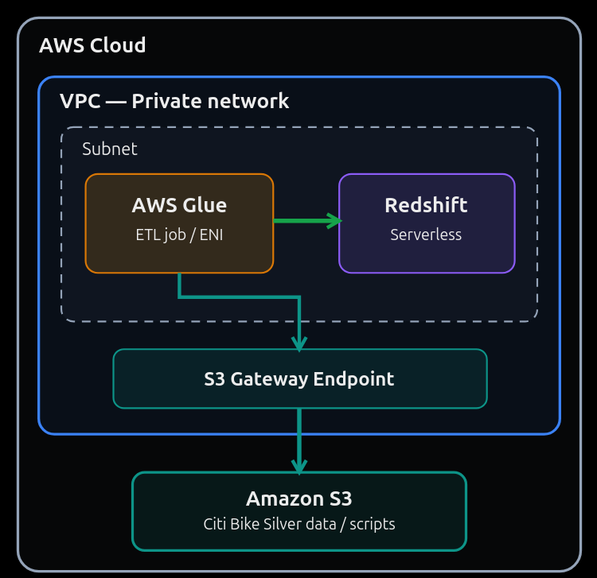

Teacher: Evan Flint

Syllabus Day 22 (per file numbering; Oct 9) - topic: cloud networking for the Glue → Redshift (Silver → Gold) step; more filled in as class goes. The roadmap lists AWS Glue for Day 22 and EMR + Redshift for Day 23. Class has been running ahead of the syllabus.

---

# Cloud Networking

Q. How do Glue, Redshift Serverless and S3 talk to each other on AWS?

A. (Teacher's definition) Cloud networking diagram:



```
AWS Cloud
└── VPC (private network)
    ├── Subnet
    │   ├── AWS Glue (ETL job / ENI) ──▶ Redshift Serverless
    │   └── AWS Glue ──▶ S3 Gateway Endpoint
    └── S3 Gateway Endpoint ──▶ Amazon S3 (Citi Bike Silver data / scripts)
```

**Expanded:** Redshift Serverless lives *inside* a private network (a VPC) and isn't reachable from the public internet. So for a Glue job to load data into it, the job has to run *inside that same network* too. That's why Evan hit the "Glue connection" step: a **Glue connection** is the setting that tells Glue "run this job inside this VPC and subnet, with these security groups."

When Glue runs inside the VPC, it plugs in with an **ENI** (a virtual network card) in the subnet. Now it can reach Redshift directly. But the private subnet has **no route to the internet**, and S3 is reached over the internet by default. So the job can't read Silver from S3 or load its script. The fix is an **S3 Gateway Endpoint**: a private door from the VPC straight to S3 that never touches the public internet.

The data path for Silver → Gold:

1. Glue starts and attaches an ENI in the subnet.
2. It reads the script and Silver Parquet from **S3**, through the **S3 Gateway Endpoint**.
3. It writes to **Redshift Serverless** over the private network. Redshift's `COPY` also pulls staged files from S3 through the TempDir.

| Piece | What it is | Why it's in the diagram |
|---|---|---|
| **VPC** (Virtual Private Cloud) | Your own private, isolated network inside AWS | Redshift Serverless (its workgroup) is placed in a VPC, so anything that talks to it must be in or connected to that network |
| **Subnet** | A slice of the VPC's IP range, in one Availability Zone | Glue's ENI and Redshift's endpoints are placed in subnets |
| **ENI** (Elastic Network Interface) | A virtual network card | How a "serverless" Glue job gets an IP address inside your subnet; created by the Glue connection |
| **Glue connection** | A Glue object holding VPC + subnet + security group (+ Redshift JDBC details/credentials) | Makes the job run inside the VPC so it can reach Redshift |
| **Security group** | A firewall on the ENI / endpoint (allowed ports and sources) | Redshift listens on port **5439**. Glue's security group also needs a **self-referencing rule** (all TCP from itself) so Glue workers can talk to each other |
| **S3 Gateway Endpoint** | A VPC route to S3 that stays on the AWS network | A private subnet has no internet route, so without it Glue can't read S3 and the job fails or hangs |
| **Amazon S3** | Object storage | Holds Silver Parquet, the Glue scripts, and the TempDir that Redshift `COPY` loads from |

| Without... | What breaks |
|---|---|
| Glue connection | Glue runs outside the VPC and can't reach Redshift (connection timeout) |
| S3 Gateway Endpoint | Glue is inside the VPC but can't reach S3 (timeouts reading the script or data) |
| Security-group rule for 5439 | Redshift refuses the connection |
| Self-referencing SG rule | Glue's "test connection" / job fails with a security-group error |

**Gateway vs Interface endpoints:**

| | Gateway endpoint | Interface endpoint (PrivateLink) |
|---|---|---|
| Services | Only **S3** and **DynamoDB** | Most AWS services |
| How it works | An entry in the subnet's **route table** | An ENI with a private IP in your subnet |
| Cost | **Free** | Billed hourly + per GB |

---

Q. What are the core AWS networking concepts?

A. (Teacher's definition)

| Concept | Explanation for beginners |
|---|---|
| VPC | A logically isolated virtual network within AWS. |
| Subnet | A range of IP addresses within a VPC, located in one Availability Zone. |
| Route table | Rules determining where network traffic is sent. |
| Internet Gateway | Provides an internet route for appropriately configured public resources. |
| NAT Gateway | Allows resources in private subnets to initiate outbound connections through a public subnet. |
| VPC Endpoint | Provides private connectivity to supported AWS services without requiring internet access. |
| Security Group | A stateful virtual firewall controlling allowed traffic. |

**Expanded:** Think of a VPC as an office building:

| Concept | Building analogy | Key detail |
|---|---|---|
| **VPC** | The building itself. Nobody gets in or out unless you add doors | Has a private IP range (CIDR block, e.g. `10.0.0.0/16`). One per region per project is typical; the account comes with a "default VPC" |
| **Subnet** | A floor of the building | Lives in **one Availability Zone** (e.g. `us-east-2a`). Use subnets in 2+ AZs for high availability |
| **Route table** | The signs in the hallway saying where each door leads | Attached to subnets. Each rule is "traffic for this IP range → go to this target" (local, Internet Gateway, NAT Gateway, gateway endpoint) |
| **Internet Gateway (IGW)** | The front door to the street | Two-way. A subnet whose route table sends `0.0.0.0/0` (everything) to the IGW is a **public subnet**. Resources also need a public IP |
| **NAT Gateway** | A mail room. Staff inside can send letters out and get replies, but strangers can't walk in | **Outbound-only** for private subnets. It sits in a public subnet. Billed per hour + per GB, so it's a common surprise on the bill |
| **VPC Endpoint** | A private tunnel straight to another AWS building (S3, Glue, etc.), never on the street | **Gateway** endpoints (S3, DynamoDB) are free route-table entries; **Interface** endpoints (most other services) are ENIs and cost money. See the table above |
| **Security Group** | A guard at each office door with a list of who's allowed in | Attached to resources (ENIs), not subnets. **Allow rules only**. **Stateful**: if a request is allowed out, its reply is allowed back in automatically |

**Public vs private subnet** is decided only by the route table:

| | Public subnet | Private subnet |
|---|---|---|
| Route for `0.0.0.0/0` | → Internet Gateway | → NAT Gateway (or none at all) |
| Reachable from the internet? | Yes, if the resource has a public IP and its security group allows it | No |
| Can reach the internet? | Yes | Only outbound, through a NAT Gateway |
| Typical residents | Load balancers, NAT Gateway, bastion hosts | Databases, Redshift, Glue job ENIs, app servers |

**How this maps to the Glue → Redshift diagram:** Glue and Redshift sit in a **private subnet** (no Internet Gateway route). The **security groups** allow Glue to talk to Redshift on port 5439. Instead of paying for a NAT Gateway just to reach S3, the subnet's **route table** sends S3 traffic to a free **S3 Gateway Endpoint**.

**Security Group vs Network ACL** (a common interview follow-up):

| | Security Group | Network ACL (NACL) |
|---|---|---|
| Applies to | A resource (its ENI) | A whole subnet |
| Rules | Allow only | Allow **and** deny |
| State | **Stateful** (replies automatically allowed) | **Stateless** (must allow both directions) |
| Default | Denies all inbound, allows all outbound | Default NACL allows everything |

---

# Agent Generated Notes (from Class Recording, live)

Source: near-live transcript of today's OBS recording (`transcriptions/Training 21 – 2026-10-09 13-07-21/live_transcript.md`), Whisper "small", no speaker labels. Timestamps are from the start of the recording.

---

## Class logistics (0:00–0:12)

- **Morning evaluations:** students compared notes on today's evaluation. Questions reported: Python list vs set vs dict, generators, garbage collection/memory management, higher-order functions (`map`/`filter`/`reduce`), pattern matching (`match`/`case`, Python's switch), a coding challenge (find duplicates in a list and return them as a list), Hadoop/HDFS, YARN, RDD vs DataFrame vs Dataset, and cache vs persist. Evan: **decorators** are a "basic competency question" in professional programming because they're used everywhere; **pattern matching** rarely comes up in interviews. On answers: "more detail is generally better."
- **Homework status around the room:** one student got the Glue → Redshift JDBC connection working; one finished Bronze → Silver and is working on Silver → Redshift; one loaded **S3 → Redshift directly** without Glue; one sent data from Spark run **locally** into Redshift because EventBridge was blocked.
- **EventBridge permissions (important for your Training 19 homework):** a student hit `scheduler:CreateSchedule` denied. Evan said he'll **make it a priority to grant everyone EventBridge Scheduler permissions** in today's hands-on part, since he didn't grant them yesterday.

---

## Why Glue and Redshift share a VPC (0:13–0:20)

Evan's explanation of the diagram (see Cloud Networking above):

- **S3 sits outside the VPC** because it's a globally available object store designed for availability. It's "generally not going to be inside your VPC."
- **Glue and Redshift are inside the same VPC** because they interact directly. Rule of thumb: **services that talk to each other should be in the same VPC**, like having them on their own local network, instead of going out to the internet and back into another private network.
- **VPC vs VPN:** same core idea (a private network), different everyday use. People use VPNs to hide traffic, resist tracking, or watch shows from another country. A real private network is computers connected locally and shielded from the internet, with a **single secure point of entry and exit**.
- **A VPC is mainly a security concept.** Outsiders have a hard time getting in because there's by design one entry point, secured to cloud standards. "The cloud forces you to practice strong security, as we are finding out firsthand in this class."
- **Subnets** are individual networks inside the VPC. They group services that talk to each other and isolate them from services that shouldn't (no cross traffic), which adds another layer of security on top of the VPC.
- In the diagram, the **gateway endpoint is inside the VPC but outside the subnet**.

---

## Evan on the networking terms (0:20–0:26)

| Term | What Evan said | Accuracy note |
|---|---|---|
| Route table | Determines where traffic is sent. Example: with non-serverless EMR you'd edit it to explicitly allow SSH from your IP (or from anywhere, which is much less secure) | Allowing SSH from your IP is actually done in the cluster's **security group** (inbound rule, port 22). The route table only decides *where* traffic goes (local, IGW, NAT, endpoint), not *who* is allowed |
| Internet Gateway | The route for resources in your VPC to reach the public internet, for example to ingest outside data | Matches the definition |
| NAT Gateway | Network address translation; compared it to how his laptop resolves `ssh morty-c137` to a Tailscale IP | That example is really **name resolution** (DNS / SSH config / Tailscale MagicDNS), not NAT. A NAT Gateway lets private-subnet resources **reach out** to the internet (e.g. download packages) while staying unreachable from outside |
| VPC Endpoint | The virtual location through which traffic can enter or exit your VPC | More precisely: a **private connection to AWS services** (S3, Glue...) that doesn't use the internet. The Internet Gateway is the general way in or out |
| Security group | A cloud firewall, for single applications or groups of them | Matches the definition |

Evan: "There's a distance between just memorizing the definitions and being able to use this to fix an actual problem."

---

## The error from yesterday's class (0:28–0:30)

Yesterday's Glue → Redshift job failed with:

```
Failed to execute with exception VPC S3 endpoint validation failed for SubnetId: <subnet-id>. VpcId: <vpc-id>.
Reason: Could not find S3 endpoint or NAT gateway for subnetId: <subnet-id>
(InvalidInputException)
```

- **What it means:** the Glue connection put the job inside Redshift's subnet. That subnet has **no route to S3**: no S3 Gateway Endpoint and no NAT Gateway. Glue checks for one before starting and refuses to run.
- **The fix** (what the diagram shows): create an **S3 Gateway Endpoint** in that VPC and attach it to the subnet's route table. It's free, unlike a NAT Gateway.
- **Evan's point about error messages:** this one is *good*. It gives the reason, the subnet ID, the VPC ID, the error code and a request ID, which is everything a knowledgeable person (or more likely an AI) needs to diagnose it.

---

## Gap in the recording (0:40–1:08, about 13:47–14:15)

OBS lost its audio at about 13:47 and then crashed at 14:03. The recording restarted at 14:15. Whatever Evan did in that gap (most likely creating the **S3 Gateway Endpoint** that fixed the networking error) isn't captured here. Fill it in from Evan's posted class video.

---

## Next Glue run: networking fixed, now an IAM error (recording 2, 0:01–0:05)

- Running the Silver → Redshift Glue job again gave a **different** error, so "perhaps the networking part is resolved." Glue now got far enough to **write temporary data to S3 for the Redshift load** (the TempDir) and was denied `s3:PutObject` there.
- Evan: "We've got an **IAM authorization** problem, not a database authentication problem."
- **Fix:** an inline policy on the existing Glue execution role (`glue-redshift-s3-policy.json`) attached with `aws iam put-role-policy --role-name ... --policy-name ... --policy-document file://...`. No output means success. Then he verified it with `aws iam simulate-principal-policy`, which showed `s3:PutObject` as **allowed**.

---

Q. What's the difference between authentication and authorization?

A. (Teacher's definition) "Authentication means that you're checked to see if you are who you say you are and that you are allowed to access the system, whereas authorization means you have already gotten access to the system, but once you have access, you are authorized to do some things versus other things." He admits he often uses the words interchangeably, "but they do have different definitions."

**Expanded:**

| | Authentication (AuthN) | Authorization (AuthZ) |
|---|---|---|
| Question | *Who are you?* | *What are you allowed to do?* |
| Happens | First | After authentication |
| Real-world | Showing your ID at the door | The wristband deciding which rooms you can enter |
| AWS examples | Signing in, access keys, a role being assumed, a Redshift username/password | IAM policies: `s3:PutObject` allowed or denied |
| Typical error | `InvalidClientTokenId`, "security token is invalid", wrong password | `AccessDenied`, `not authorized to perform: <action>` |
| HTTP status | 401 Unauthorized (confusingly named) | 403 Forbidden |

**Why it matters for debugging:** an *authentication* error means fix the credentials (wrong profile, expired key, wrong password). An *authorization* error means the identity is fine but a **policy** needs the missing action/resource. The error message usually names the exact action, role and resource, which is what Evan copied into his policy.

**`simulate-principal-policy`:** asks IAM "would this role be allowed to do X on Y?" without actually doing it. It's a quick way to verify a policy change before rerunning a 2-minute job.

---

## Student permissions update: EventBridge Scheduler granted (recording 2, 0:05–0:11)

While the Glue job reran, Evan edited the **student user group's policy** (IAM → Policies → the group's policy → edit):

- Added **`scheduler:*`** (EventBridge Scheduler full access) to the list of allowed services.
- Added **`scheduler.amazonaws.com`** to the `iam:PassedToService` condition of the "allow PassRole for service use" statement, so students can attach a role to a schedule.
- Saved the changes.

| Before | After |
|---|---|
| `scheduler:CreateSchedule` denied | Students can create and edit schedules |
| Couldn't pass a role to the Scheduler | `iam:PassRole` allowed when the role is passed to `scheduler.amazonaws.com` |

Still **not** granted (as far as the recording shows): `iam:CreateRole` / `iam:CreatePolicy`. So a student can attach an *existing* role to a schedule but can't create a new one.

---

## Silver → Gold works: first data in Redshift (recording 2, 0:10–0:16)

- A student confirmed the Scheduler permissions worked. "Since it's a group policy, it should now work for everybody."
- The **Silver → Redshift Glue job succeeded.** In Redshift → namespace `citibike-ns` → **Query editor v2** → `dev` → `public` there's now one table, `citibike_station_snapshot`:

```sql
SELECT * FROM public.citibike_station_snapshot;
```

- "Glue has populated our previously empty table with data." That was the goal of yesterday's class (and the homework bonus).
- **Next plan (Evan's intuition):** "We've got one table now, so let's use Glue to build out the rest of our **star schema** and then do some analytics with it." He took a 5-minute break to plan it.
- A student got an authentication/authorization error opening the **Redshift query editor**. Evan granted it in IAM (see next section).

**What fixed the original error, in order:** networking (S3 endpoint so the Glue job inside the VPC can reach S3) → authorization (`s3:PutObject` on the TempDir for the Glue role) → success. Each fix moved the job one step further. A *new* error after a fix is usually progress, not a setback.

---

## Student permissions update: Redshift Query editor v2 (recording 2, 0:16–0:22)

Evan: "The group policy grants `redshift` and `redshift-serverless`, but **Redshift Query editor v2 is a separate IAM prefix called `sqlworkbench`**." Students were being denied `sqlworkbench:GetAccountInfo` and `sqlworkbench:GetUserInfo`.

| Error opening the query editor | Permission added to the student group |
|---|---|
| Not authorized: `sqlworkbench:GetAccountInfo` / `GetUserInfo` | **`sqlworkbench:*`** |
| "Error occurred fetching clusters or workgroups": `tag:GetResources` | **`tag:*`** (narrower option: just `tag:GetResources`) |

- **Changes take a few seconds.** One error went away after a refresh. "Cloud is often not instantaneous."
- **Why separate prefixes:** every AWS *service* has its own IAM action prefix, and the query editor is technically its own service (its old name was "SQL Workbench"). Having `redshift-serverless:*` doesn't cover the editor, just like having `s3:*` doesn't cover Glue.
- **Why `tag:GetResources`:** the editor lists your workgroups by asking the **Resource Groups Tagging API** for Redshift resources. The workgroups exist either way; the editor just couldn't *list* them.

So students can now open Query editor v2 and run SQL against Redshift Serverless.

---

## Student permissions update: Secrets Manager (recording 2, 0:22–0:27)

- After `tag:*`, most students could open the query editor. One still got an error, because they had set up their Redshift connection the **Secrets Manager** way (Evan went the username/password route after Secrets Manager frustrated him yesterday).
- Evan added **`secretsmanager:*`** to the student group: "there's no reason to deny you access."

Q. What is AWS Secrets Manager?

A. (Teacher's definition) "Secrets Manager is for storing authentication credentials. It's a secure way to store those on the cloud." There are many reasons to be wary of storing credentials anywhere reachable from the internet, "but AWS has discovered a way to make it highly secure in a way that big organizations are able to trust." It's often used in these projects and "I even see Secrets Manager getting asked about in job interviews every once in a while."

**Expanded:** Instead of putting a database password in code, a config file or a Glue connection, you store it **once** as a *secret* (encrypted with KMS) and give services permission to **read it at runtime** (`secretsmanager:GetSecretValue`). The code only knows the secret's name or ARN.

| | Password in code / config | Secrets Manager |
|---|---|---|
| Where it lives | In the script, a `.env`, the Glue connection | Encrypted in AWS, one place |
| Who can read it | Anyone who can see the file / repo | Only identities with an IAM policy allowing `GetSecretValue` on that secret |
| Changing it | Edit every place it's copied | Update once; can **rotate automatically** (e.g. every 30 days) |
| Audit | None | Every read logged in CloudTrail |
| Cost | Free | ~$0.40 per secret per month + API calls |

How it showed up this week: creating a Glue → Redshift connection with a username/password makes Glue try to **create a secret** for it (yesterday's AccessDenied). Redshift Serverless can also **manage the admin password in Secrets Manager** for you.

Related, **Parameter Store** (in Systems Manager): also stores config and secrets, free for standard parameters, but no built-in rotation. Common interview question: "Secrets Manager vs Parameter Store?" → Secrets Manager for credentials that need rotation and auditing; Parameter Store for general config.

---

Q. Why does getting a permission granted take so long at a real job?

A. (Teacher's definition) A student noted that what's one line here "might take weeks" in production. Evan: you have to bother the person in charge, who has many other responsibilities. You have to be very specific because "they'll often only make one change," and if another permission blocks you next, "you have to go through the whole process again... making them annoyed with you for even needing to ask."

**Expanded:** This is why the error messages matter. When you request access, send the **exact action, resource ARN and role** from the error, and ideally test with `simulate-principal-policy` or read the whole job's needs **before** asking, so you can request everything in one go. Batching your asks is a professional skill.

---

## Plan for the rest of class (recording 2, 0:34–0:36, ~14:50)

Break at about 14:50. Evan's goal before class ends:

1. **Build the full star schema in Redshift** (dimensions + facts, with Glue).
2. **Ask it analytical queries** that tell us something interesting. "As of now, we haven't actually analyzed anything... The point of putting it in Redshift is to be able to say: what's this thing I want to know about the data? We formulate a SQL query based on that, and the results answer our question."
3. *If time allows:* a **Streamlit app hosted on Fargate**. With ~2 hours left, probably not today.

"If we can ask basic analytical queries on a star schema, that's going to be sufficient for a complete data pipeline built within this week's class time."

---

## Hands-on: querying Evan's table as a student (Alex, ~14:50)

| Attempt | Result | Lesson |
|---|---|---|
| `SELECT * FROM native_databases;` | `relation "native_databases" does not exist` | "native databases" is a **sidebar folder label**, not a table |
| `SELECT * FROM public.citibike_station_snapshot` while connected to `arturo-gold-wg` | `relation ... does not exist` | The query runs on the workgroup in the **editor's dropdown**, not the one clicked in the sidebar. Each workgroup is a separate warehouse |
| Same query on `citibike-wg` (federated user) | `permission denied for relation citibike_station_snapshot` | IAM let you **in**; Redshift's **own** database permissions block the **table** |

**Two layers of permissions in Redshift:**

| Layer | Controls | Managed with | Error looks like |
|---|---|---|---|
| IAM (AWS) | Who may use the query editor, connect to a workgroup, get credentials | IAM policies (`sqlworkbench:*`, `redshift-serverless:*`) | `not authorized to perform: ...` |
| Database (inside Redshift) | Which database user may read/write which schema/table | SQL `GRANT` / `REVOKE`, run by the owner or a superuser | `permission denied for relation <table>` |

A **federated user** gets a database user named after the IAM identity (e.g. `IAM:<username>`), which starts with no rights on tables other people created. Fix, run by the table owner:

```sql
GRANT USAGE ON SCHEMA public TO PUBLIC;
GRANT SELECT ON public.citibike_station_snapshot TO PUBLIC;   -- PUBLIC = every database user, not the internet
```

---

## Building the star schema (recording 2, 0:51–, ~15:06)

- Approach: "forge ahead and get a star schema going and not worry too much about the actual population of the data just yet." Setting up an incremental load into Redshift (to bring in more data) is "better reserved for next week." "The star schema is going to be the quickest route between here and where we want to be."
- **Profiling the data first.** The table had 100 rows. Rather than only `SELECT *`, Evan ran a profiling query:

```sql
SELECT COUNT(*)                   AS total_rows,
       COUNT(DISTINCT station_id) AS stations,
       MIN(snapshot_ts)           AS earliest_snapshot,
       MAX(snapshot_ts)           AS latest_snapshot
FROM public.citibike_station_snapshot;
```

Result: **100 rows, 97 stations**, earliest snapshot on Oct 7. (The column names above follow Evan's description; check the real names in the editor's sidebar.) A pasted query first gave a syntax error near `public`; re-copying it fixed it. That's often a hidden character from copy/paste.

**Expanded:** **Data profiling** means answering "what do I actually have?" before modeling it: row count, distinct keys, date range, nulls. Here it shows a tiny sample: 100 rows across 97 stations means roughly one snapshot per station, not the thousands of 5-minute snapshots Bronze holds. Analytics on that won't say much until more data is loaded.

**Watch out:** the query editor's **Limit 100** toggle (on by default) caps what `SELECT *` *displays* at 100 rows. `COUNT(*)` isn't affected by it, which is why Evan confirmed the count with `COUNT(*)` instead of trusting the row count shown.

---

## Data checks before modeling (recording 2, 0:54–0:59)

- **Data range:** earliest snapshot Oct 7, 6:28 PM; latest Oct 8, 8:55 PM.
- **Duplicate check:**

```sql
SELECT station_id, snapshot_ts, COUNT(*) AS occurrences
FROM public.citibike_station_snapshot
GROUP BY station_id, snapshot_ts
HAVING COUNT(*) > 1
ORDER BY occurrences DESC;
```

0 rows returned → **no duplicates** (each station appears at most once per snapshot time).

- **Copy/paste syntax errors:** pasted queries kept throwing syntax errors that vanished after cutting and re-pasting (Ctrl+X, Ctrl+V). Evan's habit from now on: paste, then cut and re-paste. The likely cause is invisible characters (non-breaking spaces, smart quotes) coming from the chat or browser.

---

Q. What's the difference between WHERE and HAVING? (common interview question)

A. (Teacher's definition) "They're both ways of filtering, but WHERE is going to be used when we do a simple query like a SELECT, and HAVING is going to be used after we do an aggregation, such as GROUP BY... HAVING is the correct predicate to use after you have done an aggregation, whereas WHERE is the correct predicate to use if you are not doing any aggregation."

**Expanded:** They run at different points in the query's order of execution:

```
FROM → WHERE → GROUP BY → HAVING → SELECT → ORDER BY → LIMIT
```

| | WHERE | HAVING |
|---|---|---|
| Filters | Individual **rows**, before grouping | **Groups**, after aggregation |
| Can use aggregates (`COUNT`, `SUM`, `AVG`)? | No (`WHERE COUNT(*) > 1` is an error) | Yes, that's its purpose |
| Example | `WHERE bikes_available = 0` (only empty-station rows) | `HAVING COUNT(*) > 1` (only groups with duplicates) |
| Both together | `WHERE is_operational` first drops rows, then `GROUP BY station_id HAVING AVG(bikes_available) < 2` keeps stations that average under 2 bikes | |

**Performance tip:** filter with WHERE whenever you can. Fewer rows go into the GROUP BY, so it's faster.

---

Q. What star schema is Evan building for Citi Bike?

A. (Teacher's definition) `dim_station`, `fact_station_snapshot` and `dim_date` "as a very basic star schema... A fact table stores measurable observations and foreign keys; dimensions provide descriptive attributes." Picture "the fact table in the center, and the dimension tables all around it, connected to the fact table with lines."

**Expanded:**

```
                dim_station
         (station_key, station_id, name,
          lat, lon, capacity, ...)
                     │
                     │ station_key
                     ▼
          fact_station_snapshot
   (station_key, date_key, snapshot_ts,
    bikes_available, ebikes_available,
    docks_available, utilization,
    is_empty, is_full, is_operational)
                     ▲
                     │ date_key
                     │
                 dim_date
     (date_key, full_date, day_of_week,
      is_weekend, month, year, ...)
```

| Table | Type | One row per | Holds |
|---|---|---|---|
| `fact_station_snapshot` | Fact | Station per snapshot | **Measures** (numbers you add/average) + foreign keys |
| `dim_station` | Dimension | Station | **Descriptions**: name, location, capacity |
| `dim_date` | Dimension | Calendar date | Day of week, weekend flag, month, so you can ask "weekday vs weekend?" without date math |

Questions this answers: Which stations are empty most often? How does availability change by hour or by weekday vs weekend? Which areas are always full? (Recap of star schemas: `Training 5.md`.)

---

## Creating the Gold schema and tables (recording 2, 1:00–1:06)

- The star picture is conceptual: "in the query editor it's just going to be a list of tables. Some are labeled fact and others dimension."
- **Simplification for today:** use the natural `station_id` as the station dimension's key (no surrogate key).
- Created a separate **schema** `gold` (instead of `public`), then the tables:

```sql
CREATE SCHEMA IF NOT EXISTS gold;

CREATE TABLE IF NOT EXISTS gold.dim_station (
    station_id   VARCHAR(...) PRIMARY KEY,   -- a string, not an integer
    station_name VARCHAR(500),
    capacity     INT
);

CREATE TABLE IF NOT EXISTS gold.dim_date ( ... );

CREATE TABLE IF NOT EXISTS gold.fact_station_snapshot (
    station_id, date_key, snapshot_ts,
    bikes_available, ebikes_available, docks_available,
    utilization_pct, is_empty, is_full, is_operational
)
DISTKEY (...) SORTKEY (...);
```

(Column list as Evan read it aloud; exact types/keys were on screen.) A `CREATE TABLE` returns **0 rows**. "It shouldn't return any rows, it should just create a table with a schema."

---

Q. Why create dimension tables before fact tables?

A. (Teacher's definition, after asking AI) "The fact table typically references dimension tables through foreign keys, so the dimensions need to be populated first to establish those relationships."

**Expanded:** Two reasons: (1) a fact table declaring `REFERENCES gold.dim_station(station_id)` can't be created until that table exists; (2) when loading, each fact row needs a matching dimension row to point to (or to look up a surrogate key from). **Redshift detail:** primary and foreign keys in Redshift are **informational only, not enforced**. Redshift won't stop you from inserting a duplicate key or an orphan fact row. The optimizer uses them as hints, so keeping them true is *your* job (that's why Evan ran the duplicate check first).

---

Q. Why didn't `DESCRIBE TABLE gold.dim_date` work?

A. (Teacher's definition) It gave a syntax error. Evan moved on.

**Expanded:** Redshift (based on PostgreSQL) has **no `DESCRIBE` command**. That's MySQL/Snowflake/Hive syntax. In Redshift, use:

```sql
SELECT column_name, data_type
FROM information_schema.columns
WHERE table_schema = 'gold' AND table_name = 'dim_date';
-- or
SELECT * FROM pg_table_def WHERE schemaname = 'gold' AND tablename = 'dim_date';  -- needs schema on search_path
```

Or just expand the table in the query editor's left sidebar.

---

Q. What are DISTKEY and SORTKEY?

A. (Teacher's definition) "Distribution keys and sort keys are two ways of organizing tables in Redshift. We'll look into the ways those are used going forward."

**Expanded:** Redshift is **MPP** (Training 18): a table's rows are spread across many compute slices.

| | DISTKEY (distribution key) | SORTKEY (sort key) |
|---|---|---|
| Decides | **Which slice** each row lives on (rows with the same key value go together) | **The order** rows are stored on disk within a slice |
| Goal | Joins/aggregations on that column happen locally, with no shuffling data between nodes | Range filters (e.g. a time window) skip blocks that can't match ("zone maps") |
| Good choice | The column you join on most (e.g. `station_id`) | The column you filter on most (e.g. `snapshot_ts`) |
| Spark equivalent | Partitioning / bucketing by key (avoid shuffles, Training 7) | Sorting + min/max statistics in Parquet |

Distribution styles: `KEY` (by a column), `ALL` (a full copy on every node, good for small dimension tables), `EVEN` (round-robin), `AUTO` (Redshift decides; the default).

---

Q. What's the difference between DELETE, TRUNCATE and DROP? (common interview question)

A. (Teacher's definition) "DELETE removes data, does not remove table structure. TRUNCATE removes all rows, does not remove the table. DROP TABLE is what you need to drop the entire table." A student added the interview point: "TRUNCATE will just get rid of all the rows, whereas DELETE goes one by one by one, so it's less efficient at deleting a whole table." Evan: "This is something I should know off the top of my head and be able to explain."

**Expanded:**

| | DELETE | TRUNCATE | DROP |
|---|---|---|---|
| Removes | Rows matching `WHERE` (or all rows without one) | **All** rows | The whole table: rows **and** structure |
| Can filter? | Yes (`DELETE FROM t WHERE ...`) | No | No |
| How | Row by row, marks each deleted | Releases the table's storage in one go | Removes the table definition |
| Speed on a big table | Slow | Fast | Fast |
| Table still exists after? | Yes | Yes | **No** |
| Redshift specifics | Leaves deleted rows taking space until `VACUUM` | **Commits immediately; can't be rolled back** inside a transaction | Use `DROP TABLE IF EXISTS` in reruns |
| Typical use | Remove specific bad rows | Empty a table before a full reload (Evan's use here) | Remove a table you no longer need |

**Why TRUNCATE before INSERT here:** it makes the load **rerunnable** (idempotent). Running the script twice gives the same result instead of duplicate rows.

---

## Populating dim_station: one row per station (recording 2, 1:08–1:12)

```sql
TRUNCATE TABLE gold.dim_station;

INSERT INTO gold.dim_station (station_id, station_name, capacity)
SELECT station_id, station_name, capacity
FROM public.citibike_station_snapshot
WHERE station_id IS NOT NULL              -- a row without a station ID is invalid
QUALIFY ROW_NUMBER() OVER (
    PARTITION BY station_id
    ORDER BY snapshot_ts DESC, station_name DESC, capacity DESC
) = 1;                                    -- keep only the newest row per station
```

Q. What does QUALIFY do?

A. (Teacher's definition) "QUALIFY filters the results of a window function, much like WHERE filters ordinary rows. You use WHERE in a simple query, you use HAVING in an aggregation, you use QUALIFY with a window function." `ROW_NUMBER()` is a window function, "we can tell because it has an OVER clause." Here it "ensures that only one record per station is inserted into gold.dim_station: keeps only the rows whose assigned row number equals one." Example: three rows for a Broadway station get numbered 1, 2, 3 within that station, and only #1 is kept.

**Expanded:** The three filters, in the order SQL applies them:

| Clause | Filters | Runs after |
|---|---|---|
| WHERE | Rows | FROM |
| HAVING | Groups | GROUP BY |
| QUALIFY | Window-function results | Window functions (after SELECT expressions are computed) |

**This is the classic "latest record per key" (deduplication) pattern.** `PARTITION BY station_id` restarts the numbering for each station; `ORDER BY snapshot_ts DESC` makes #1 the most recent; `= 1` keeps just that row. So each station's *current* name and capacity go into the dimension.

QUALIFY works in **Redshift, Snowflake, BigQuery and Databricks**, but **not** PostgreSQL or MySQL. There you wrap it in a subquery/CTE:

```sql
SELECT station_id, station_name, capacity
FROM (
    SELECT *, ROW_NUMBER() OVER (PARTITION BY station_id ORDER BY snapshot_ts DESC) AS rn
    FROM public.citibike_station_snapshot
    WHERE station_id IS NOT NULL
) t
WHERE rn = 1;
```

| Window function | Ties get | Use |
|---|---|---|
| `ROW_NUMBER()` | Different numbers (1, 2, 3) | Exactly one row per group (dedup) |
| `RANK()` | Same number, then a gap (1, 1, 3) | Top-N where ties all count |
| `DENSE_RANK()` | Same number, no gap (1, 1, 2) | Ranking without gaps |

---

- **Result:** `INSERT` affected **97 rows**. 100 snapshot rows minus 3 extra rows for stations that appeared twice = one row per station.
- `SELECT * FROM gold.dim_station;` shows `station_id` values that mix letters and numbers ("that's why it's VARCHAR and not an integer"), New York cross-street names (e.g. W 180 St & Fort Washington Ave) and `capacity` (that station has 24 docks).

**Expanded: always check affected rows against what you expect.** 97 rows = the 97 distinct stations from the profiling query, so the dedup worked. If the numbers didn't match, that would be the first sign of a bug.

---

## Populating dim_date (recording 2, 1:15–1:18)

Columns: `date_key`, `calendar_date`, `year_number`, `month_number`, `day_number`, `day_of_week`.

```sql
TRUNCATE TABLE gold.dim_date;

INSERT INTO gold.dim_date (date_key, calendar_date, year_number, month_number, day_number, day_of_week)
SELECT DISTINCT
    CAST(TO_CHAR(snapshot_ts, 'YYYYMMDD') AS INT) AS date_key,      -- e.g. 20261008
    CAST(snapshot_ts AS DATE)                    AS calendar_date,
    EXTRACT(YEAR  FROM snapshot_ts)              AS year_number,
    EXTRACT(MONTH FROM snapshot_ts)              AS month_number,
    EXTRACT(DAY   FROM snapshot_ts)              AS day_number,
    EXTRACT(DOW   FROM snapshot_ts)              AS day_of_week     -- 0 = Sunday ... 6 = Saturday
FROM public.citibike_station_snapshot
WHERE snapshot_ts IS NOT NULL;
```

(Reconstructed from Evan's walkthrough; the exact expressions were on screen.)

Q. What does SELECT DISTINCT do, and why use it here instead of QUALIFY?

A. (Teacher's definition) "SELECT DISTINCT is a SQL command that will allow you to select only those parts of the table which are not duplicates." It's used here instead of QUALIFY "because we are not needing to use a window function." Evan pointed out that this is starting to look like **ELT**: the transformation (pulling year/month/day/day-of-week out of `snapshot_ts`) happens **inside the warehouse with SQL**, after the data was loaded.

**Expanded:**

| | SELECT DISTINCT | QUALIFY ROW_NUMBER() = 1 |
|---|---|---|
| Removes rows that are | **Identical in every selected column** | Duplicates **by a key**, even if other columns differ |
| Picks which duplicate? | Doesn't matter (they're identical) | You choose with `ORDER BY` (e.g. newest) |
| Used for | `dim_date`: many snapshots share one date → identical date rows | `dim_station`: same station, possibly different name/capacity across snapshots |

**ETL vs ELT:** ETL transforms *before* loading into the warehouse (Spark/Glue, Bronze → Silver). ELT loads first and transforms *inside* the warehouse with SQL (this step, and dbt in Training 17).

**`date_key` as `YYYYMMDD` integer:** a common data-warehouse convention. It's readable (20261008), sorts correctly and joins fast. A real `dim_date` is usually pre-filled with *every* date for years, not just dates present in the data, so days with no data still show up in reports.

---

- **Result:** `dim_date` got **2 rows**. "Not at all surprising": all the data is from Oct 7 and 8. Same year and month, different day / day of week / calendar date.
- **Why it's incomplete:** Evan only runs the EventBridge schedule during class. "If we were actually trying to manage this data for business purposes, we'd want the EventBridge scheduler running 24 hours a day," so new snapshots arrive every 5 minutes and `dim_date` grows each day.

---

## Populating the fact table (recording 2, 1:19–1:24)

`TRUNCATE` first, then a long `INSERT ... SELECT` from `public.citibike_station_snapshot`:

| Fact column | Comes from |
|---|---|
| `station_id` | Same column (the link to `dim_station`) |
| `date_key` | **New:** `CAST(TO_CHAR(snapshot_ts, 'YYYYMMDD') AS INT)` (the link to `dim_date`) |
| `snapshot_ts`, `bikes_available`, `ebikes_available`, `docks_available`, `utilization_pct`, `is_empty`, `is_full`, `is_operational` | Same columns |
| *(capacity)* | **Not** in the fact table. It's a description of the station, so it lives in `dim_station` |

Filters: `WHERE station_id IS NOT NULL AND snapshot_ts IS NOT NULL`, plus `QUALIFY ROW_NUMBER() ... = 1` to drop duplicates.

**Result: 100 rows**, and `date_key` came out as `20261008`. "Yes, that is how you represent a date as an integer." `TO_CHAR` turns the timestamp into the text `'20261008'`, and `CAST(... AS INT)` turns that text into the number 20261008.

**Expanded:**
- **Why capacity moved out:** facts hold things that **change every snapshot** (bikes, docks). Dimensions hold things that **describe** the entity and rarely change (name, capacity). Repeating capacity on every fact row would waste space, and if it changed you'd have to update thousands of rows instead of one.
- **Why 100 rows here but 97 in `dim_station`:** the fact table is one row per **station per snapshot**, so the dedup key must be `(station_id, snapshot_ts)`, which has no duplicates (from the earlier check). `dim_station` is one row per **station**, so 3 stations with two snapshots collapsed. Getting the **grain** (what one row means) right is the most important decision in a fact table.

---

## Validating the star schema (recording 2, 1:24–1:30)

With one fact table and two dimensions, `gold` holds "a simple star schema residing in our data warehouse." Before analyzing it, Evan ran three **validation** queries:

**1. Row counts per table**

```sql
SELECT 'dim_station' AS table_name, COUNT(*) AS row_count FROM gold.dim_station
UNION ALL
SELECT 'dim_date', COUNT(*) FROM gold.dim_date
UNION ALL
SELECT 'fact_station_snapshot', COUNT(*) FROM gold.fact_station_snapshot;
```

Result: fact = 100, dim_station = 97, dim_date = 2. `UNION ALL` "is going to just combine them" into one result table.

**2. Referential integrity: orphaned facts**

```sql
SELECT COUNT(*) AS orphaned_facts
FROM gold.fact_station_snapshot f
LEFT JOIN gold.dim_station s ON f.station_id = s.station_id
WHERE s.station_id IS NULL;
```

Result: **0**. Evan: facts are **orphaned** "if they are contained in the fact table but not contained in the dimension table. Anything that we would look up in the dimension table regarding that entry in the fact table would not return the information we're looking for." `f` and `s` are **aliases** (short names) for the two tables.

**3. Duplicate facts**

```sql
SELECT station_id, snapshot_ts, COUNT(*)
FROM gold.fact_station_snapshot
GROUP BY station_id, snapshot_ts
HAVING COUNT(*) > 1;
```

Result: **0** duplicates.

Next step (after questions): **"analytical queries that tell a story."**

**Expanded:**

| Concept | Meaning | Why it matters here |
|---|---|---|
| **Referential integrity** | Every foreign key in a child table matches a row in the parent table | Redshift **doesn't enforce** foreign keys, so you must check yourself |
| **Orphaned fact** | A fact row whose key has no matching dimension row | It would silently drop out of any report that INNER JOINs to the dimension |
| **LEFT JOIN + `WHERE right.key IS NULL`** | The **anti-join** pattern: "rows in A with no match in B" | The standard way to find orphans, missing records, or new-vs-existing rows |
| `UNION` vs `UNION ALL` | `UNION` removes duplicate rows (slower); `UNION ALL` keeps everything | Use `UNION ALL` unless you need dedup; here every row is different anyway |

These three checks (counts, orphans, duplicates) are a reusable **data-quality checklist** after any load. dbt's `relationships` and `unique` tests (Training 17) automate exactly these.

---

## Evan's check-in questions (recording 2, 1:30–1:36)

Q. Why run the validation queries?

A. (Teacher's definition) A student: "Because it's the gold layer, to make sure everything is as wanted." Evan: "That's basically the reason. We want to make sure that everything is as we'd like it to be, so having no duplicates and no orphaned facts, so that we can be sure nothing is wrong with the data before we do anything more advanced with it."

**Expanded:** A successful load only proves rows were inserted, not that they're right, and Redshift doesn't enforce primary/foreign keys. So counts, orphan checks and duplicate checks are how *you* guarantee Gold is trustworthy before dashboards and decisions are built on it. In production these become automated tests (dbt `unique` / `not_null` / `relationships`, Glue Data Quality) that fail the pipeline.

---

Q. What's the rationale for organizing a warehouse as a star schema (fact + dimension tables)?

A. (Teacher's definition) A student: "for organizing analytical and business data properly so we can quickly search up what we need," with "simpler query logic." Evan wanted more: "It's a **dimensional data model, which is basically the gold standard for how to organize analytical data**. The stuff that is most centrally important... is stored in the fact table, which is conceptually at the center of the schema. Information that helps us expand on the facts is contained in the various dimension tables. When we're analyzing, the central information is in the fact table, and anything that relates the fact table to anything else, we can achieve by joining the fact table with a dimension table," or with other SQL operations like UNION ALL.

**Expanded:** The fuller answer interviewers want: measurements at a declared **grain** go in a narrow fact table; descriptive context goes in dimensions. That gives **no repeated descriptions** (stored once, changed once), **business logic defined once** (weekend, borough, rush hour), **simple, predictable queries** (fact + joins + group by), **speed** on columnar MPP warehouses (narrow facts, small dimensions copied to every node), **consistent answers** across teams (conformed dimensions) and **managed history** (slowly changing dimensions). Full detail: `walkthroughs/Deep Dive - Star Schema (Facts and Dimensions).md`.

---

# Analytical Queries on the Star Schema

## Query 1: Which stations have the most bikes available? (recording 2, 1:53–2:00)

Evan: "If I'm looking for a bike, which station am I most likely to actually find one at?"

```sql
SELECT s.station_name,
       s.capacity,
       ROUND(AVG(f.bikes_available), 0) AS avg_bikes_available,
       ROUND(AVG(f.utilization_pct), 0) AS avg_utilization_pct,
       COUNT(*)                         AS observations
FROM gold.fact_station_snapshot f
JOIN gold.dim_station s ON f.station_id = s.station_id
GROUP BY s.station_id, s.station_name, s.capacity
HAVING COUNT(*) >= 2
ORDER BY avg_bikes_available DESC
LIMIT 15;
```

(Reconstructed from Evan's walkthrough; exact on-screen text may differ slightly.)

How Evan read it:
- **Aliases:** `f` = the fact table, `s` = `dim_station` (same as in the validations). Name and capacity come from the **dimension**; the numbers come from the **fact**.
- **`ROUND`:** ordinary rounding to a whole number. **`AS avg_bikes_available`** gives the column "a name that is actually going to be comprehensible."
- **`ORDER BY ... DESC`:** most bikes first. **`LIMIT 15`:** at most 15 rows.

**Result: only 3 rows** (even with `LIMIT 15`), because `HAVING COUNT(*) >= 2` keeps only stations with at least two snapshots, and only 3 of the 97 had two:

| Station | Avg bikes available | Capacity |
|---|---|---|
| 78 Ave & Queens Blvd S (Queens) | ~23 | 29 |
| Arlington Ave & Warwick St | ~16 | 18 |
| W 181 St & Fort Washington Ave | ~3 | |

Evan then looked up the top station on Google Maps (Queens) to show how a query result turns into a real-world answer: "if you're looking to rent a bike, you can go..."

**Accuracy note:** at first Evan read `HAVING COUNT(*) >= 2` as "filtering out anything that doesn't have at least two **bikes** available." It actually counts **rows (snapshots) per station**: it drops stations observed fewer than 2 times, so an average over a single snapshot doesn't rank as a "usual" value. He then correctly explained the 3 results as stations with at least two observations.

**Expanded:**
- This is the star-schema query shape in action: **fact in the middle, join the dimension, group by its attributes, aggregate the measures.**
- **`AVG(bikes_available)`** is right (not `SUM`): it's a semi-additive measure, so summing across snapshots would count the same bikes over and over.
- **`AVG(utilization_pct)`** averages a ratio. It's fine *per station* (all snapshots share the same capacity), but averaging it *across stations* would weight a 5-dock station the same as a 60-dock one.
- `GROUP BY s.station_id, s.station_name, s.capacity`: every non-aggregated column in `SELECT` must be in `GROUP BY`. Grouping by the ID too keeps two different stations with the same name apart.
- With 100 rows over two days, the result is a demo, not a conclusion. That's why Evan wants more data loaded next week.

---

- **Where the top 3 are:** 78 Ave & Queens Blvd S is in **Queens** next to Flushing Meadows Corona Park. Arlington Ave & Warwick St is in **Cypress Hills, Queens** near Forest Park (the first Google result was in Providence, RI: "sometimes you have to be more specific"). W 181 St & Fort Washington Ave is in **Washington Heights, Manhattan**. "We've built this whole data pipeline to be able to come up with these three stations where we might actually find a bike available to rent."

---

## Query 2: Which stations are most frequently empty? (recording 2, 2:03–)

"The opposite query: where are we most likely to come up short if we walk over to get a bike and find it's not there?"

```sql
SELECT s.station_name,
       COUNT(*)                                                           AS observations,
       SUM(CASE WHEN f.is_empty THEN 1 ELSE 0 END)                        AS empty_observations,
       ROUND(100.0 * SUM(CASE WHEN f.is_empty THEN 1 ELSE 0 END)
             / NULLIF(COUNT(*), 0), 1)                                    AS pct_observations_empty
FROM gold.fact_station_snapshot f
JOIN gold.dim_station s ON f.station_id = s.station_id
GROUP BY s.station_id, s.station_name
ORDER BY pct_observations_empty DESC;
```

(Reconstructed; exact text was on screen.)

Q. What is CASE WHEN?

A. (Teacher's definition) "This is how you can implement a conditional in SQL. It's sort of like if you're writing Python or really any programming language, Swift, Kotlin; it exists everywhere: if statements." `CASE WHEN f.is_empty THEN 1 ELSE 0 END` marks each empty snapshot as 1 and every other as 0; summing those gives the number of times the station was empty.

**Expanded:**

```sql
CASE
    WHEN condition_1 THEN result_1      -- like: if
    WHEN condition_2 THEN result_2      -- like: elif
    ELSE default_result                  -- like: else (NULL if omitted)
END
```

| Pattern | What it does | Example |
|---|---|---|
| `SUM(CASE WHEN x THEN 1 ELSE 0 END)` | **Conditional count**: how many rows meet a condition | Empty snapshots per station |
| `100.0 * SUM(CASE ...) / COUNT(*)` | **Percentage** of rows meeting a condition | % of time empty |
| `AVG(CASE WHEN x THEN 1.0 ELSE 0 END)` | Same percentage, shorter | `AVG(CASE WHEN f.is_empty THEN 1.0 ELSE 0 END)` |
| `CASE WHEN bikes = 0 THEN 'Empty' WHEN bikes < 3 THEN 'Low' ELSE 'OK' END` | **Bucketing** into categories | Availability level |
| `COUNT(*) FILTER (WHERE x)` | Conditional count in PostgreSQL | Not supported in Redshift, so use `SUM(CASE ...)` |

**`NULLIF(COUNT(*), 0)`** (Evan said he'd have to look it up): `NULLIF(a, b)` returns **NULL if a equals b**, otherwise `a`. Dividing by NULL gives NULL instead of a **division-by-zero error**, so it's a safety guard for percentages. **`100.0`** (not `100`) forces decimal math; integer ÷ integer in SQL can truncate to 0.

---

**Running Query 2 (recording 2, 2:06–2:11):**
- First run failed: **"The current limit of three sessions has been reached."** The query editor allows only a few open sessions (tabs with *Isolated session* on). Fix: close tabs you're done with, or reuse one tab and comment out old queries with **Ctrl + /** (Cmd + / on Mac).
- With `HAVING COUNT(*) >= 2`, it returned the **same three stations** as Query 1 (the only ones with 2+ snapshots). Evan **removed the HAVING** to see all stations.
- Result: several stations were empty in **100%** of their observations: **Grand Army Plaza & Plaza St W**, **Fort Liberty Ferry Terminal**, **St Johns Pl & Utica Ave**, **11 Ave & W 27 St**. "Our data isn't rich enough to have a value between 0 and 100." With 1 snapshot per station, every percentage is 0% or 100%. More data will fix that.
- He also removed the HAVING from Query 1 and sorted by **utilization**: Hudson St & N Moore St had the highest; **E 47 St & 1 Ave** (next to the UN) the lowest. A student pointed out it also has a much bigger **capacity (70** vs 47 and 35), so lower *percentage* utilization doesn't necessarily mean fewer riders. "Good catch."

**Expanded: small samples and denominators.**
- **Sample size:** a percentage from 1 observation is either 0% or 100%. That's why `HAVING COUNT(*) >= N` exists: it hides results built on too little data. Removing it shows more stations but less reliable numbers. A good habit is to always show `observations` next to any average or percentage, as Evan's queries do.
- **Denominator effects:** utilization % = something ÷ capacity. A 70-dock station with 20 bikes out looks "less used" (29%) than a 20-dock station with 10 out (50%), even though more bikes are out. Compare **absolute** numbers alongside **percentages** before drawing conclusions. This is the same non-additive-ratio issue from the star-schema deep dive.

---

## Query 3: How does bike availability change by hour? (recording 2, 2:11–)

```sql
SELECT EXTRACT(HOUR FROM f.snapshot_ts)   AS hour_utc,
       ROUND(AVG(f.bikes_available), 0)   AS avg_bikes,
       ROUND(AVG(f.utilization_pct), 0)   AS avg_utilization,
       COUNT(*)                           AS observations
FROM gold.fact_station_snapshot f
GROUP BY EXTRACT(HOUR FROM f.snapshot_ts)
ORDER BY hour_utc;
```

- `EXTRACT(HOUR FROM snapshot_ts)` "is going to be the essential line that divides it up by hour." No dimension join needed: it groups the fact table by a part of its own timestamp.
- **Hours are UTC.** 8 AM New York time (EDT) shows as hour 12. Convert with `CONVERT_TIMEZONE('UTC', 'America/New_York', snapshot_ts)` before extracting the hour if you want local rush hours.
- In a fuller model this is exactly what a **`dim_time`** dimension (hour, `is_rush_hour`, `day_part`) is for (see the deep dive).

---

**Query 3 result (recording 2, 2:13–2:15):** only three hours have data, because the schedule only runs during class: hours **18, 19 and 20**. Evan read these as 6, 7 and 8 PM. Average availability rose from about **48% to 55%** across them. His guess: fewer people rent after 8 PM, more earlier in the day, and "probably more people rent bikes on weekends than weekdays." A chart in the AI output was only an example of what the SQL *could* drive with real data ("more for if we got the Streamlit app together"); Redshift's editor doesn't draw that.

**Accuracy note: those hours are UTC, not New York time.** `snapshot_ts` is stored in UTC (the Bronze keys and Spark job set UTC). Hours 18–20 UTC = **2–4 PM EDT**, which matches when the scheduler actually ran during class (Oct 7 ~2:28 PM onward). So the data says nothing about evenings. It's mid-afternoon on two weekdays. Always label time columns with their zone (Evan's alias `hour_utc` does) and convert before interpreting:

```sql
EXTRACT(HOUR FROM CONVERT_TIMEZONE('UTC', 'America/New_York', f.snapshot_ts)) AS hour_ny
```

---

## Query 4: Which stations may have operational problems? (recording 2, 2:15–2:18)

```sql
SELECT s.station_name,
       COUNT(*)                                                     AS observations,
       SUM(CASE WHEN f.is_operational = FALSE THEN 1 ELSE 0 END)    AS non_operational_observations,
       ROUND(100.0 * SUM(CASE WHEN f.is_operational = FALSE THEN 1 ELSE 0 END)
             / NULLIF(COUNT(*), 0), 1)                              AS pct_non_operational
FROM gold.fact_station_snapshot f
JOIN gold.dim_station s ON f.station_id = s.station_id
GROUP BY s.station_id, s.station_name
-- HAVING COUNT(*) >= 2      (removed: not enough data)
ORDER BY pct_non_operational DESC
LIMIT 20;
```

Same conditional-count + percentage pattern as Query 2, applied to `is_operational`. Result: percentages only 100 or 0, "because we are not working with rich data at the moment."

**Expanded:** `is_operational = false` comes from the Silver logic (Training 19): stations that are installed but not renting/returning, or that report the `last_reported: 86400` placeholder. A station that's *always* non-operational is likely out of service; one that *flips* often may have a hardware/kiosk problem. That's the kind of question an operations team would actually use this table for.

---

## Query 5: Compare stations across days (recording 2, 2:18–)

"We've only got two days' worth of data, so this isn't going to give us much, but it will give us something." Per `calendar_date` (from `dim_date`): `COUNT(DISTINCT station_id)` as stations observed, `COUNT(*)` as total observations, rounded averages of bikes available and utilization, and a count of empty observations.

**Expanded:** `COUNT(DISTINCT station_id)` vs `COUNT(*)`: distinct stations seen that day vs total snapshot rows. If 97 stations produced 100 rows, a few were seen twice. Comparing the two is a quick way to see how many observations each entity has.

---

**Query 5 result:** average bikes available was **20 on Oct 7 (Wednesday)** vs **15 on Oct 8 (Thursday)**. "That's really the only conclusion we can come to. If we had more data we could make more observations." (With different stations and hours sampled each day, even that comparison isn't apples to apples.)

**Where this goes next (Evan):** enrich the data for better analysis, "perhaps make some forecasts, some predictions," and see patterns across the week. **Maybe next week: run the ingestion 24 hours a day** (he'll check the cost first).

---

Q. Are there "design patterns" for SQL, like factory or adapter in software? (student question)

A. (Teacher's definition) "That's actually a very good question." What we saw were regular ways to compute things like percentages. Evan wasn't aware of patterns applied to SQL the way they are to languages "you use to build things rather than analyze things," since architectural patterns are about constructing something. "You could call it analytical patterns." He then asked AI, which said **yes**. For example, the closest SQL equivalent of the **factory pattern** (encapsulating how records are created or returned) is the **stored procedure**.

Q. What is a stored procedure?

A. (Teacher's definition) "If you're going to be making the same query frequently, it's going to be very useful to create a stored procedure in order to just be able to call on that whenever you want, rather than having to write out the same SQL over and over again." Not covered yet "because we've been building things instead of analyzing things."

**Expanded:** A stored procedure is named SQL logic saved **inside the database**, called with `CALL`. It can take parameters, run several statements, use variables, loops and `IF`, and wrap a load in a transaction:

```sql
CREATE OR REPLACE PROCEDURE gold.refresh_dim_station()
AS $$
BEGIN
    TRUNCATE TABLE gold.dim_station;
    INSERT INTO gold.dim_station (station_id, station_name, capacity)
    SELECT station_id, station_name, capacity
    FROM public.citibike_station_snapshot
    WHERE station_id IS NOT NULL
    QUALIFY ROW_NUMBER() OVER (PARTITION BY station_id ORDER BY snapshot_ts DESC) = 1;
END;
$$ LANGUAGE plpgsql;

CALL gold.refresh_dim_station();
```

| Reusable SQL object | What it is | Use for |
|---|---|---|
| **View** | A saved `SELECT`; runs fresh each time | Hiding join logic (e.g. a pre-joined fact + dimensions view for analysts) |
| **Materialized view** | A saved `SELECT` whose **results are stored** and refreshed | Expensive aggregations queried often (dashboards) |
| **Stored procedure** | Saved **steps** (DML, logic, transactions), called with `CALL` | Repeatable loads like today's TRUNCATE + INSERT sequence |
| **User-defined function (UDF)** | Saved calculation returning a value | Reusable formulas (e.g. a utilization formula) |

**SQL / analytics patterns worth knowing by name** (all used this week):

| Pattern | Shape | Where we used it |
|---|---|---|
| Latest record per key (dedup) | `QUALIFY ROW_NUMBER() OVER (PARTITION BY key ORDER BY ts DESC) = 1` | `dim_station` load |
| Anti-join (find missing) | `LEFT JOIN b ... WHERE b.key IS NULL` | Orphaned-facts check |
| Duplicate detection | `GROUP BY key HAVING COUNT(*) > 1` | Validations |
| Conditional aggregation | `SUM(CASE WHEN cond THEN 1 ELSE 0 END)` | Empty / non-operational counts |
| Safe percentage | `100.0 * part / NULLIF(total, 0)` | Queries 2 and 4 |
| Star join | Fact + dimension joins, `GROUP BY` dimension attributes | Every analytical query |
| Truncate-and-load (idempotent full refresh) | `TRUNCATE` then `INSERT ... SELECT` | Gold loads |
| Upsert / MERGE (incremental) | `MERGE INTO target USING source ON key WHEN MATCHED ... WHEN NOT MATCHED ...` | Next step: loading only new snapshots |
| SCD Type 2 | Close the old row (`valid_to`), insert a new version | Tracking station capacity changes |
| Top-N per group | `ROW_NUMBER()` / `RANK()` with `QUALIFY ... <= N` | "Top 3 stations per borough" |
| CTE pipeline | `WITH step1 AS (...), step2 AS (...) SELECT ...` | Breaking a long query into readable steps |

---

- The AI's list continued: the **observer pattern** (react to changes in data) maps to **triggers** and **CDC** (change data capture); SQL's own patterns include **MERGE / upsert** and even the **star schema** itself. Evan: "I'm familiar with a lot of these concepts, I just never put them through my head as what's equivalent to a design pattern." He'll read the article and follow up.

**Expanded:** **CDC (change data capture)** reads a database's change log (inserts/updates/deletes) and streams just the changes downstream (e.g. Debezium → Kafka, AWS DMS). It's how warehouses stay in sync with app databases without full reloads. A **trigger** is code a database runs automatically when a row changes. Triggers are common in OLTP databases; Redshift doesn't support them.

---

Q. Will data engineers actually analyze Gold data, or just build it? (student question)

A. (Teacher's definition) "There are definitely situations where data engineers are asked to analyze data," including using **BI tools like Power BI, Tableau, Amazon QuickSight** to produce maps and charts for reports, or building pipelines that feed **ML or generative AI models**. Data scientists more commonly do that, "but data engineering bleeds into all of its adjacent fields. Data engineers will often be asked to do data science things, ML and AI things, DevOps things... depending on the client." "Why go to all the trouble of building out that huge data pipeline if we're not going to actually use the data?"

Q. What does Evan mean by "full stack AI"?

A. (Teacher's definition) The whole discipline, end to end:

| Stage | What you do | Where it's covered |
|---|---|---|
| **DevOps / infrastructure** | Deploy and take down cloud infrastructure | **Terraform** day, next week |
| **Pipeline building** | Take data from the source, process it, put it where it needs to be | Training 19–21 (S3, Lambda, EMR, Glue, Redshift) |
| **Analysis** | SQL analysis, visualizations | Today; BI tools / Streamlit |
| **ML and generative AI** | Train the model, deploy it, evaluate it ("is it hallucinating?") | Later |
| **MLOps** | **MLflow**: feed clean data to the model, train it, improve results over time | "If we have time in this class" |

Evan says theoretical ML is one of his weaker subjects: he knows regression and clustering, and how to deploy a model and run a framework. There's demand for people with these skills.

**Expanded:**

| Tool | What it is |
|---|---|
| **Terraform** | Infrastructure as Code: describe AWS resources (buckets, roles, Lambda, Redshift) in `.tf` files, then `terraform apply` creates them all and `terraform destroy` removes them. It would have replaced most of this week's console clicking and CLI commands, and fixed the "someone else's job overwrote mine" problem with reviewed, versioned definitions |
| **MLflow** | Open-source MLOps platform: **tracks experiments** (parameters, metrics, models per training run), a **model registry** (versions, staging → production), and **serving** |
| **Regression** | Predicting a number (e.g. bikes available at 8 AM tomorrow) |
| **Clustering** | Grouping similar items without labels (e.g. commuter stations vs leisure stations) |

---

- **On learning it all:** very few people know every step, and even after ~7 years Evan constantly looks things up and asks AI: "an absolute mountain of information." What's achievable is to **understand conceptually what all the steps are and how everything fits together**, and look up the details. Detailed syntax knowledge used to justify high salaries; now "an entry-level programmer who started learning Java last week can ask AI how to do that." There's strong demand for people who can do **both data engineering and MLOps**.

---

# Homework (Training 21, weekend)

Evan: "I don't want to unnecessarily stress you out... your homework is going to be to **try and get as close to where I've gotten to as possible**. And since you all now have **EventBridge permissions**, you can **run the ingestion pipeline over the weekend and enrich the data** you're working with."

Reference ChatGPT sessions Evan posted in the Teams chat:
1. The main lesson on the pipeline (Glue Silver → Redshift Gold, star schema, analytical queries)
2. Richard's question about SQL design patterns
3. SQL methods such as TRUNCATE (DELETE vs TRUNCATE vs DROP)
4. Reasons to create dim tables before fact tables in Redshift
5. Granting permissions in IAM (the student group policy changes)
6. The networking material from the first hour (VPC, subnets, endpoints)

---

**Official homework wording (2:39):** develop your own pipeline "to the full extent that it was in class": ingestion in **Lambda** → **S3**; **EMR or Glue** for Bronze → Silver (you don't need to do both), then Silver → Gold; Gold as a **star schema**; then **basic analytical queries** "to answer natural-language questions about what the data can tell us." "Make it so that on your side it looks like it does on my side." Class ended ~16:57: "Have a great weekend, see you Monday."

---
