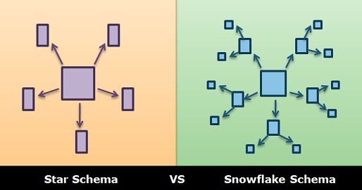

Teacher: Evan Flint

Syllabus Day 6: SQL Fundamentals
Coverage: Joins, aggregations, CTEs, window functions, subqueries, query plans, indexing and interview prep.

---

## Video Resources

| Title | Link |
|---|---|
| What is a Data Warehouse? | https://www.youtube.com/watch?v=k4tK2ttdSDg |
| Database vs Data Warehouse vs Data Lake \| What is the Difference? | https://www.youtube.com/watch?v=-bSkREem8dM |
| SQL Data Warehouse from Scratch \| Full Hands-On Data Engineering Project | https://www.youtube.com/watch?v=9GVqKuTVANE&list=PLNcg_FV9n7qaUWeyUkPfiVtMbKlrfMqA8 |
| Let's Compare the Kimball and Inmon Data Warehouse Architectures | https://www.youtube.com/watch?v=Tff34jj_V-0 |
| Data Lakehouses Explained | https://www.youtube.com/watch?v=Enu-EH7RHHM |
| Intro to Data Lakehouse | https://www.youtube.com/watch?v=myLiFw9AUKY |

---

## References

| Topic | Link |
|---|---|
| Database Normalization | [Wikipedia - Database normalization](https://en.wikipedia.org/wiki/Database_normalization) |
| Edgar F. Codd | [Wikipedia - Edgar F. Codd](https://en.wikipedia.org/wiki/Edgar_F._Codd) |
| Surrogate Key | [Wikipedia - Surrogate key](https://en.wikipedia.org/wiki/Surrogate_key) |

---

# Analytical Databases: On-Premises vs Cloud

Q. What are the main on-premises and cloud options for analytical databases (data warehouses)?

A. (Teacher's definition)

**On-Premises Analytical Databases:**
- **Hive** - old school Hadoop stack data warehouse - a bit outdated
- **DuckDB** - an analytical database which must be used in conjunction with an OTF (Open Table Format) format file like Iceberg, but which can build a modern analytical database locally

**Cloud Analytical Databases:**
- **AWS** - Redshift
- **Microsoft Azure** - either Azure Synapse Analytics or Databricks Delta Lake
- **GCP** - BigQuery
- **Snowflake** - an independent company, but which requires some kind of connection to either AWS, Azure, or GCP for most functionality

Expanded: this is a map of where analytical workloads (the OLAP side of the OLTP-vs-OLAP distinction from `Training 0.md`, and the data warehousing concepts from `Training 4.md`) actually get *run* today, split by who hosts the infrastructure. "On-premises" here loosely includes anything you install and run yourself (even DuckDB on a laptop) versus a managed cloud service billed by usage. Notice Snowflake's odd position: unlike Redshift/BigQuery (which are native, first-party services of their own cloud), Snowflake is a separate company that still has to physically run on top of AWS, Azure, or GCP's underlying infrastructure - it doesn't own its own data centers the way the big three do.

| System | Category | Notes |
|---|---|---|
| Hive | On-premises | Original Hadoop-stack SQL data warehouse (HiveQL over MapReduce/Spark); considered outdated today, largely superseded by faster engines |
| DuckDB | On-premises | Lightweight, embeddable analytical database - runs locally like SQLite, but for OLAP. Has its own native database file (`.duckdb`) and queries Parquet/CSV/JSON directly; Iceberg/Delta support is an optional extension |
| Redshift | Cloud (AWS) | AWS's native columnar data warehouse (see `Training 4.md` for its columnar-storage architecture) |
| Azure Synapse Analytics | Cloud (Azure) | Microsoft's native analytics platform (serverless/dedicated SQL pools + Spark) |
| Microsoft Fabric (Warehouse / Lakehouse) | Cloud (Azure) | Microsoft's newer unified analytics SaaS on OneLake (Delta format); where Microsoft is steering new warehouse work (see `Training 31.md`) |
| Databricks Delta Lake | Cloud (Azure, or other clouds) | Lakehouse approach - object storage + Delta format + Spark compute (see `Training 4.md`'s Databricks section) |
| BigQuery | Cloud (GCP) | Google's native serverless data warehouse |
| Snowflake | Cloud (independent, but runs on top of AWS/Azure/GCP) | Separates storage from compute (see `Training 4.md`); doesn't own its own infrastructure - deploys on top of one of the three major clouds |

Expanded (correction):

| Teacher's statement | More precise fact |
|---|---|
| DuckDB "must be used in conjunction with an OTF format file like Iceberg" | Not required. DuckDB has its own native single-file database format (`.duckdb`) and can query Parquet, CSV and JSON files directly. Iceberg and Delta are optional extensions, useful when you want a lakehouse-style table format |
| Snowflake "requires some kind of connection to either AWS, Azure, or GCP" | You choose which cloud and region your Snowflake account runs in, but you do **not** need your own AWS/Azure/GCP account. Your own cloud account only matters for external stages (e.g. your S3 bucket), storage integrations and private networking |
| Azure = Synapse or Databricks | Also **Microsoft Fabric** (Warehouse and Lakehouse on OneLake). Synapse dedicated SQL pools are effectively legacy for new projects |

---

## Note on Databricks

Q. Does Databricks have a purpose-built analytical database like Redshift or BigQuery?

A. (Teacher's definition) Databricks doesn't have a purpose built analytical database, but using Delta Lake + Delta Format is effectively the same architecture as building a local one using DuckDB and Iceberg.

Expanded: unlike Redshift or BigQuery - each a single, self-contained, proprietary warehouse product - Databricks is really a *compute engine* (Spark) paired with an *open table format* (Delta) sitting on top of plain object storage (S3/ADLS/GCS). That combination of "engine + open table format + object storage" is architecturally the same pattern as running DuckDB (the engine) against Iceberg-formatted files (the open table format) locally - just at cloud/distributed scale instead of on a laptop. So Databricks Delta Lake and a self-built DuckDB + Iceberg setup aren't different categories of thing; they're the same architectural pattern applied at two different scales, which is why the "Cloud (Azure, or other clouds)" categorization for Databricks Delta Lake in the table above is a bit different in kind from Redshift/BigQuery's - it's a lakehouse pattern, not a monolithic managed database.

Expanded (correction): this is outdated. Databricks now has a purpose-built SQL engine for BI: **Databricks SQL warehouses** (serverless option, running the **Photon** vectorized C++ engine) that serve SQL/BI queries over Delta tables. So the architecture is still "engine + open table format + object storage", but Databricks does offer a dedicated warehouse-style SQL product on top of it. Also note Delta Lake itself is open source (Linux Foundation), not Databricks-only.

---

## OLAP

Q. What does OLAP stand for?

A. (Teacher's definition) OLAP - Online Analytical Processing.

Expanded: this is the category of workload every system on this page exists to serve - queries that scan, join, and aggregate large volumes of historical data to answer analytical questions, as opposed to OLTP (Online Transaction Processing), which handles small, fast, single-row reads/writes for live applications. See `Training 0.md` for the full OLTP-vs-OLAP breakdown and comparison table - Hive, DuckDB, Redshift, Synapse, Delta Lake, BigQuery, and Snowflake above are all, at the end of the day, different implementations built specifically to make OLAP workloads fast.

---

# Dimensional Schemas

Q. Who is Ralph Kimball, and why does he come up when discussing dimensional schemas?

A. Ralph Kimball is the data warehousing pioneer credited with developing **dimensional modeling** - the methodology behind the fact/dimension table, star-schema approach already introduced in `Training 4.md`'s "Building a Small Data Warehouse in PostgreSQL" section. His approach (often called the "Kimball methodology") emphasizes building a warehouse as a set of business-process-oriented star schemas, designed to be intuitive for analysts to query directly - as opposed to the competing Inmon methodology, which builds a single normalized enterprise-wide model first and derives departmental marts from it afterward.

Expanded:

| | Kimball (bottom-up) | Inmon (top-down) |
|---|---|---|
| Core model | Dimensional (star schemas) per business process | Normalized (3NF) enterprise data warehouse |
| Build order | Build data marts first, integrate them through **conformed dimensions** | Build the central EDW first, then derive data marts from it |
| Time to first value | Fast | Slower, more upfront design |
| Query simplicity | High - analysts query stars directly | Lower on the EDW; marts are added for analysts |
| Typical today | Most cloud warehouses and dbt projects | Large enterprises needing one integrated, normalized source of truth |

**Interview line:** "Kimball is bottom-up: star-schema marts per business process, tied together with conformed dimensions. Inmon is top-down: a normalized enterprise warehouse first, then marts. Most modern cloud teams use Kimball-style stars, often in the Gold layer."

---

## Star Schema

Q. What is a Star Schema?

A. (Teacher's definition) Star Schema - the basic "denormalized" model.

Expanded: "denormalized" is the key word - a star schema deliberately duplicates/flattens descriptive data into wide dimension tables (`dim_customer`, `dim_product`, `dim_date`, etc. - see `Training 4.md`) instead of splitting it across many normalized tables the way an OLTP application database would. This trades storage efficiency and update-safety (the concerns normalization solves) for query simplicity and speed - a star schema needs far fewer joins to answer an analytical question, since one `fact_sales` table joins directly out to each dimension in a single "star" shape, rather than chaining through several layers of normalized lookup tables. This is why it's called the "basic" model - it's the simplest, most direct dimensional design, before getting into more normalized variants like the snowflake schema.

---

## Snowflake Schema

Q. What is a Snowflake Schema?

A. (Teacher's definition) Snowflake Schema - a normalized extension of the star schema.



Expanded: a snowflake schema takes a star schema's flat dimension tables and normalizes them further, splitting each one into multiple related sub-tables (e.g. `dim_product` might split into `dim_product` -> `dim_product_category` -> `dim_product_line`, each holding its own attributes without repeating them). Visually this makes the dimensions branch outward like a snowflake's points instead of staying as simple flat "points" of a star - hence the name. It reduces data redundancy (closer to a normalized OLTP design) at the cost of needing more joins per query, which is the opposite trade-off from the star schema's denormalized simplicity.

**Naming gotcha - don't confuse with the *company* Snowflake** (the cloud analytical database from earlier in this file). A snowflake schema is a *table design pattern* usable in any relational database (Postgres, Redshift, BigQuery, Snowflake-the-company, etc.) - the shared name is coincidental, not a feature specific to that vendor.

| | Star Schema | Snowflake Schema |
|---|---|---|
| Dimension tables | Flat, denormalized | Split into normalized sub-tables |
| Joins per query | Fewer (one hop to each dimension) | More (may chain through sub-tables) |
| Data redundancy | Higher (attributes repeated) | Lower (normalized, no repetition) |
| Query simplicity | Simpler, faster for analysts | More complex, more joins to write |
| Best for | Most modern analytical warehouses (simplicity favored) | Cases where storage/redundancy control matters more than query simplicity |

**Interview line:** "A star schema has one fact table joined directly to flat, denormalized dimensions, so queries need few joins. A snowflake schema normalizes the dimensions into sub-tables, saving some redundancy but adding joins. I'd default to star for analytics, since storage is cheap and BI tools and analysts work best with fewer joins."

---

## Galaxy Schema

Q. What is a Galaxy Schema?

A. (Teacher's definition) Galaxy Schema - don't mention this in an interview, but it basically describes a data warehouse with multiple star and/or snowflake schemas.

Expanded: also called a "fact constellation" schema, a galaxy schema is what most real-world warehouses actually look like once they've grown past a single business process - multiple fact tables (e.g. `fact_sales`, `fact_shipping`, `fact_returns`) coexisting and often sharing some of the same dimension tables (e.g. all three might reference the same `dim_product` or `dim_date`). It's less a deliberate "design" someone picks upfront and more the natural, expected shape a warehouse takes on as more business processes get modeled into it over time.

**Career note (teacher's advice):** don't bring this term up in an interview - it's more of a descriptive label for "a warehouse with several stars/snowflakes in it" than a named design pattern interviewers are testing for, unlike Star and Snowflake schema which are standard, expected vocabulary.

---

## Fact Table

Q. What is a Fact Table?

A. (Teacher's definition) The fact table is the central organizing table of the data warehouse - all other data in the warehouse is related in some way to the facts in the fact table. The data that's stored in the fact table is called "elementary facts" - depending on the situation, these could be facts of various kinds, but it's useful to think of them in the beginning as usually being sales.

Expanded: already covered in depth in `Training 4.md`'s "Building a Small Data Warehouse in PostgreSQL" section - a fact table holds the measurable events at the center of a star/snowflake schema (e.g. `fact_sales`: `quantity`, `unit_price`, `revenue`, plus foreign keys out to each dimension). It's the table full of numbers and IDs, as opposed to a dimension table, which holds descriptive attributes about those events. "Central organizing table" is the key idea here: every dimension table's whole purpose is to describe *something referenced by the fact table* - there's no dimension floating around unconnected to a fact - which is exactly the hub-and-spoke shape visible in the star/snowflake diagram above. See `Training 4.md` for the full `CREATE TABLE warehouse.fact_sales` example and row-level walkthrough.

"Elementary facts" just means the individual measurable values sitting in each fact row (a `quantity`, a `unit_price`, a `revenue` amount) - "elementary" because they're the smallest, most granular unit of measurement the warehouse tracks, before any aggregation (`SUM`, `AVG`, etc.) is applied on top. Sales is the default teaching example because it's the most intuitive "thing that happened and can be measured" - but the same pattern applies to any measurable business event (shipments, page views, support tickets, sensor readings, etc.).

---

## Worked Example: Widget Store Data Warehouse

Q. (Teacher's worked example setup) Let's say we're doing a data warehouse for a store that sells widgets.

When a widget is purchased, there must have been a customer that purchased the widget.

So, we have a customers table.

Sometimes, an employee would have helped the customer buy the widget, so we have an employees table.

That sale would have been made at a store, so if we have multiple stores then there will be a stores table.

A. Model the **sale** as the fact and the things that describe it as dimensions. `customers`, `employees` and `stores` become `dim_customer`, `dim_employee` and `dim_store` (plus `dim_product` and `dim_date`), and `fact_sales` holds one row per **line item** (the grain) with foreign keys to each dimension and the measures `quantity`, `unit_price` and `sales_amount`. A sale with no assisting employee gets a special "Unknown/None" employee row rather than a NULL key.

```text
dim_customer   dim_employee   dim_store
        \           |           /
         +------ fact_sales ----+
        /    (one row per line item)
dim_product                dim_date
```

---

# Database Normalization

Q. Who is Edgar F. Codd, and why does he come up when discussing database normalization?

A. Edgar F. Codd is the researcher who invented the **relational model** for databases (the theoretical basis for every SQL database covered in this training) and later formalized the concept of **normalization** and the normal forms (1NF, 2NF, 3NF, etc.) as a way to systematically eliminate data redundancy and inconsistency in a relational schema's design.

Expanded: Codd published the relational model in 1970 at IBM. It is built on relational algebra (selection, projection, join), which is what SQL implements.

---

## Normal Forms

### 1st Normal Form (1NF)

Q. What is the 1st Normal Form?

A. (Teacher's definition) 1st Normal Form - all cells in a relational database should contain one value and one value only.

Expanded: this rules out storing multiple values crammed into a single column - e.g. a `phone_numbers` column holding `"555-1234, 555-5678"` violates 1NF, since that one cell actually holds two separate facts. The fix is either splitting those values into their own dedicated columns (if the count is fixed and small) or, more commonly, moving them into a separate related table (e.g. a `customer_phones` table with one row per phone number, linked back via a Foreign Key) - which is itself an early example of the same normalization principle that leads toward proper table design.

| Violates 1NF | Satisfies 1NF |
|---|---|
| `phone_numbers = "555-1234, 555-5678"` (one cell, two values) | Separate `customer_phones` table: one row per phone number |

---

### 2nd Normal Form (2NF)

Q. What is the 2nd Normal Form?

A. (Teacher's definition) 2nd Normal Form - use a Primary Key to uniquely identify rows in a table.

Expanded: this builds on 1NF by requiring every table to have a Primary Key so each row is unambiguously identifiable (see the Primary Key/Foreign Key entry in `Training 4.md`). The fuller textbook version of 2NF (Codd's original formulation) goes one step further and specifically targets tables with a **composite** Primary Key (spanning multiple columns): every non-key column must depend on the *entire* composite key, not just part of it - a "partial dependency" on only one piece of the key is what 2NF eliminates. For a table with a single-column Primary Key, this concern doesn't really arise, which is why the simpler framing here ("just have a proper Primary Key") is the right first mental model before digging into composite-key edge cases.

---

### 3rd Normal Form (3NF)

Q. What is the 3rd Normal Form?

A. (Teacher's definition) 3rd Normal Form - remove transitive dependencies.

Expanded: a **transitive dependency** happens when a non-key column depends on *another non-key column*, rather than depending directly on the Primary Key. For example, in an `employees` table with `employee_id` (PK), `department_id`, and `department_name`: `department_name` doesn't really depend on `employee_id` directly - it depends on `department_id`, which in turn depends on `employee_id`. That's a transitive chain (`employee_id -> department_id -> department_name`). 3NF fixes this by pulling `department_name` out into its own `departments` table (keyed by `department_id`), so `employees` only stores the `department_id` Foreign Key - exactly the Primary Key/Foreign Key pattern already covered in `Training 4.md`'s `departments`/`employees_demo` worked example.

| Violates 3NF | Satisfies 3NF |
|---|---|
| `employees(employee_id, department_id, department_name)` - `department_name` transitively depends on `employee_id` through `department_id` | `employees(employee_id, department_id)` + separate `departments(department_id, department_name)` table |

---

### The General Pattern Across Normal Forms

Q. What's the overall trade-off as a database becomes more normalized?

A. (Teacher's definition) A more normalized database has more tables, but each of those tables has less data in it. Because each table has less data, queries are faster because the system needs to look at less data for the same query. But, that logic breaks down when data from diverse sources needs to be queried, because that means that we have to write more joins.

Expanded: this is the throughline connecting 1NF, 2NF, and 3NF above - each normal form works by splitting data out into an additional table (multi-valued cells become their own table for 1NF, partial dependencies get split off for 2NF, transitive dependencies get split off for 3NF). The result is a schema with more tables, each one narrower/simpler, with every piece of data stored in exactly one place. This is the direct opposite of a **star schema's** deliberately denormalized dimension tables (`Training 5.md`'s Star Schema entry above) - which is why OLTP application databases (favoring normalization, to protect against inconsistent updates) and OLAP data warehouses (favoring denormalization, to minimize joins) end up designed so differently, even though they're both "just" relational databases underneath.

Expanded (correction): the main purpose of normalization is not faster reads. Normalization **reduces redundancy and prevents update, insert and delete anomalies** (a fact stored in one place can't get out of sync), and it favors **writes** (OLTP). Reads that need data from several tables usually get **slower**, because they need joins. That is exactly why analytical systems denormalize.

**Interview line (normalization vs denormalization):** "Normalize OLTP systems to avoid redundancy and update anomalies and keep writes cheap. Denormalize for analytics, like a star schema, to cut joins and make reads fast, accepting some redundancy."

The "logic breaks down" part is the whole reason data warehouses exist: normalization's speed benefit (scanning a smaller, narrower table) only holds when a query stays within one or two tables. An analytical question that has to pull together customer, product, order, and payment data all at once pays a real cost for every extra `JOIN` needed to reassemble that normalized data - which is exactly the cost a denormalized star schema is designed to avoid, at the price of some redundancy and update complexity.

---

# Dimension Table

Q. What is a Dimension Table, and how many does a dimensional schema need?

A. (Teacher's definition) A dimensional schema always has at least one fact table, and always has multiple dimension tables. In a star schema, all dimension tables are connected to the fact table via a Foreign Key.

Expanded: a Dimension Table holds the descriptive, contextual attributes about the events recorded in a fact table - the "who, what, where, when" surrounding each fact (already introduced via `dim_customer`, `dim_product`, and `dim_date` in `Training 4.md`, and building now via `customers`, `employees`, and `stores` in the widget-store worked example above). The 1-to-many relationship stated here (one or more fact tables, always multiple dimensions) reflects why the shape is called a "star" in the first place: a single fact table sits at the center, with several dimension tables radiating outward around it, each one describing a different angle of the same event. A dimensional schema with only one dimension table wouldn't really need the star pattern at all - the multiplicity of dimensions is what makes denormalizing into a dedicated dimension table (rather than just flattening everything into the fact table itself) worthwhile.

The Foreign Key connection is what actually makes the star shape work mechanically, not just conceptually: the fact table (e.g. `fact_sales`) stores a Foreign Key column for every dimension it references (`customer_id`, `employee_id`, `store_id`, ...), each pointing back at that dimension table's Primary Key - exactly the Primary Key/Foreign Key relationship covered in `Training 4.md`. This is also precisely why a star schema needs fewer joins than a fully normalized OLTP design: every dimension is exactly *one join hop* away from the fact table, never buried two or three tables deep.

**Star vs snowflake, precisely (teacher's definition):** In a snowflake schema, some dimension tables are not connected to the fact table, but rather are connected to other dimension tables with a Foreign Key. This "all dimensions connect directly to the fact table via FK" rule from above is specific to a **star** schema - in a **snowflake** schema, a sub-dimension table (e.g. `dim_product_category`, split off from `dim_product`) connects to *another dimension table* instead, not directly to the fact table. That's exactly the extra normalization layer the Snowflake Schema entry above describes, and why snowflake queries need more joins than star queries.

---

## Dimensional Modeling Vocabulary (Interview Staples)

Q. What types of fact tables are there?

A. Three classic types (Kimball):

| Fact table type | One row per... | Example |
|---|---|---|
| Transaction | Individual event, at the finest grain | One line item on a receipt (`fact_sales`) |
| Periodic snapshot | Entity per regular time period | Account balance per customer per day; inventory level per product per week |
| Accumulating snapshot | Process instance, updated as it moves through milestones | One row per order with `ordered_date`, `shipped_date`, `delivered_date` filled in over time |
| Factless fact | Event or coverage with no numeric measure | Student attended class; product was on promotion that day |

---

Q. What are additive, semi-additive and non-additive measures?

A. It describes which dimensions a measure can be summed across.

| Type | Can be summed across... | Example |
|---|---|---|
| Additive | All dimensions | `sales_amount`, `quantity` |
| Semi-additive | Some dimensions, but not time | Account balance, inventory level (sum across accounts is fine; summing daily balances over a month is meaningless, use average or last value) |
| Non-additive | No dimensions | Ratios and percentages like profit margin, unit price (recompute from additive parts instead) |

---

Q. What are conformed and degenerate dimensions?

A. A **conformed dimension** is one dimension table (same keys, same meaning) shared by several fact tables, e.g. one `dim_date` and one `dim_product` used by both `fact_sales` and `fact_returns`, so results from different stars can be compared. A **degenerate dimension** is a dimension key kept in the fact table with no dimension table of its own, e.g. `order_number` in `fact_sales`: useful for grouping line items into orders, but it has no other attributes.

Expanded: conformed dimensions are what make the Kimball "bus architecture" (and a galaxy schema) work. Other common terms: a **junk dimension** groups low-cardinality flags (e.g. `is_gift`, `payment_type`) into one small table; a **role-playing dimension** is one table used in several roles (`dim_date` as order date and ship date).

---

# Data Visualization

Q. How do data visualization tools relate to OLAP data warehouses?

A. (Teacher's definition) Data visualization tools are very commonly connected to OLAP data warehouses, because the warehouses are optimized to do the mathematical operations which are needed to produce result data that's useful for visualization.

Expanded: a chart or dashboard (Power BI, Tableau, etc. - see the diagram in `Training 4.md`'s "Where Warehouse Data Comes From" section) doesn't do its own heavy aggregation - it sends a query and renders whatever result set comes back. The reason that query targets an OLAP warehouse rather than an OLTP application database is exactly what was covered in the Database Normalization section above: a denormalized star schema can compute a `SUM`/`AVG`/`GROUP BY` across millions of rows in one efficient query, while a normalized OLTP database would need many expensive joins to reassemble the same answer. So the pipeline is: OLTP app database -> ETL/ELT -> OLAP warehouse (pre-aggregated, denormalized, indexed for scanning) -> visualization tool queries the warehouse and renders the numbers it gets back.

---

## Python Data Visualization Libraries

Q. What Python visualization libraries should I know?

A. (Teacher's definition) In pure Python, there are a few libraries to be aware of:

- **Matplotlib** - the most basic, low-level data visualization library for Python. It gives you a lot of control, but also a lot of responsibility.
- **Seaborn** - gives a selection of higher-level APIs where you can put the data into Pandas and visualize them directly, and be sure that the charts are going to be within modern standards of how a chart should look.
- **Plotly** - a competitor to Seaborn.

Expanded:

| Library | Style | Best for |
|---|---|---|
| Matplotlib | Low-level, full control | Custom static charts; the base other libraries build on |
| Seaborn | High-level, built on Matplotlib, works directly with Pandas | Quick, good-looking statistical charts |
| Plotly | High-level, interactive (HTML/JS output) | Interactive charts and dashboards (Dash, Streamlit) |

---

## BI (Business Intelligence) Tools

Q. What dedicated BI tools should I know?

A. (Teacher's definition) Beyond pure Python libraries, there are also dedicated BI tools:

- **Microsoft Power BI**
- **Tableau**
- **AWS QuickSight**
- **Looker**

Expanded:

| BI tool | Vendor / cloud affinity |
|---|---|
| Power BI | Microsoft (Azure, Fabric) |
| Tableau | Salesforce, cloud-neutral |
| QuickSight | AWS |
| Looker | Google Cloud (semantic layer, LookML) |

---

## Python + Postgres Visualization Setup (Hands-On)

Q. (Teacher's setup command) What do you need to install to connect Python to Postgres and visualize data with Seaborn/Matplotlib?

A. (Teacher's definition)
```bash
pip install pandas sqlalchemy psycopg2-binary seaborn matplotlib
```

Expanded: this installs the full chain needed to go from a live Postgres database to a rendered chart: `sqlalchemy` (the connection engine, same one used in `Training 4.md`'s ETL pipeline example) talks to Postgres via `psycopg2-binary` (the actual low-level Postgres driver `sqlalchemy` calls under the hood), `pandas` loads query results into a DataFrame (`pd.read_sql`, from `Training 2.md`), and `seaborn`/`matplotlib` render that DataFrame as a chart - `seaborn` for the higher-level API, `matplotlib` since Seaborn is itself built on top of it and Matplotlib's lower-level functions (`plt.show()`, `plt.savefig()`, etc.) are usually still needed to finish displaying/saving a Seaborn plot.

---

# Worked Example: Converting `bd_sql_training` into a Star Schema

Q. What does it actually look like to convert the class's operational tables into a warehouse-style star schema?

A. Evan was independently prototyping this exact lesson in ChatGPT (shared links), building it against his own personal practice database. Rather than run his exact steps against our homework database (which would have broken `homework4_answers.sql` by renaming/altering the tables it depends on), the same conversion was replicated in a separate practice database, **`warehouse_practice`**, copied from `bd_sql_training` - the original homework tables were left untouched.

**Approach - rename tables in place, then add what's missing:**
```sql
-- Dimensions
ALTER TABLE customers RENAME TO dim_customer;
ALTER TABLE employees RENAME TO dim_employee;
ALTER TABLE offices RENAME TO dim_office;
ALTER TABLE products RENAME TO dim_product;

-- Facts
ALTER TABLE orderdetails RENAME TO fact_sales;
ALTER TABLE payments RENAME TO fact_payment;
```

**The exact same data quality bug from `Training 4.md` had to be fixed here too:** `fact_sales.quantity` (originally `orderdetails.quantity`) actually held a line number, and what was labeled `product_category` actually held the true quantity ordered. Evan's own ChatGPT session hit this same discovery mid-conversation - it first suggested simply `DROP COLUMN product_category` as a "redundant" duplicate of `dim_product.product_category`, then retracted that instruction once diagnostic queries (`COUNT(DISTINCT product_category) GROUP BY product_number`) revealed the values varied per-order in a way no real category would - i.e., don't drop a column until you've confirmed what it actually contains:
```sql
ALTER TABLE fact_sales RENAME COLUMN quantity TO order_line_number;
ALTER TABLE fact_sales RENAME COLUMN product_category TO quantity;
ALTER TABLE fact_sales ALTER COLUMN quantity TYPE INTEGER USING quantity::INTEGER;
ALTER TABLE fact_sales ADD COLUMN sales_amount NUMERIC(12,2);
UPDATE fact_sales SET sales_amount = price * quantity;
```

**Building `dim_date`** (no existing date dimension - generated from the `orders` table's date range, matching the `Training 4.md` `dim_date` pattern):
```sql
CREATE TABLE dim_date (
    date_key INTEGER PRIMARY KEY,
    full_date DATE UNIQUE NOT NULL,
    year INTEGER, quarter INTEGER, month INTEGER, month_name VARCHAR(20),
    day INTEGER, day_of_week INTEGER, day_name VARCHAR(20)
);

INSERT INTO dim_date
SELECT TO_CHAR(d, 'YYYYMMDD')::INTEGER, d::DATE,
       EXTRACT(YEAR FROM d)::INTEGER, EXTRACT(QUARTER FROM d)::INTEGER,
       EXTRACT(MONTH FROM d)::INTEGER, TO_CHAR(d, 'FMMonth'),
       EXTRACT(DAY FROM d)::INTEGER, EXTRACT(ISODOW FROM d)::INTEGER, TO_CHAR(d, 'FMDay')
FROM generate_series(
    (SELECT MIN(order_date) FROM orders),
    (SELECT MAX(order_date) FROM orders),
    INTERVAL '1 day'
) d;

ALTER TABLE fact_sales ADD COLUMN order_date_key INTEGER;
UPDATE fact_sales f SET order_date_key = d.date_key
FROM orders o JOIN dim_date d ON o.order_date = d.full_date
WHERE f.order_number = o.order_number;
```

**Verified result** - a real star-schema analytical query, run against `warehouse_practice`:
```sql
SELECT p.product_category, SUM(f.sales_amount) AS total_revenue
FROM fact_sales f
JOIN dim_product p ON f.product_number = p.product_number
GROUP BY p.product_category
ORDER BY total_revenue DESC;
```
```
product_category | total_revenue
------------------+---------------
Classic Cars      |    3853922.49
Vintage Cars      |    1797559.63
Motorcycles       |    1121426.12
Trucks and Buses  |    1024113.57
Planes            |     954637.54
Ships             |     663998.34
Trains            |     188532.92
```

**Honest limitation, not swept under the rug:** `dim_customer`, `dim_employee`, and `dim_office` exist as properly-shaped dimension tables, but there's currently no Foreign Key path connecting them to `fact_sales`/`fact_payment` - the source `orders`/`orderdetails` tables never captured which customer or employee a sale belonged to. Evan's own planning notes (from the second ChatGPT link) sketched exactly this same disconnected `dim_customer` in his target architecture diagram. This is a realistic, common warehouse problem: a dimension can exist and be perfectly well-formed, but is only actually *useful* once the source data captures the key needed to join it to a fact.

---

# Data Lakehouse vs Data Warehouse

Q. What is the difference between a Data Lakehouse and a Data Warehouse?

A. A **Data Warehouse** is structured, schema-on-write - data is transformed and organized (typically into a star/snowflake schema) *before* it's loaded, using structured tables in a system optimized for SQL analytics (Redshift, Snowflake, BigQuery, Synapse). A **Data Lakehouse** is the newer hybrid approach (Databricks' pitch, from `Training 4.md`): raw files (Parquet/Delta) sit cheaply in object storage (S3/ADLS/GCS) in a schema-on-read style, but an open table format (Delta Lake, Iceberg) layered on top adds warehouse-like guarantees - ACID transactions, schema enforcement, time travel - that a plain data lake never had.

| | Data Warehouse | Data Lakehouse |
|---|---|---|
| Storage | Structured tables inside the warehouse system itself | Files (Parquet/Delta/Iceberg) in cheap object storage |
| Schema | Schema-on-write (enforced before load) | Schema-on-read, but with enforcement added by the table format |
| Data types | Structured/relational only | Structured, semi-structured, and unstructured (images, logs, JSON, etc.) |
| Workload | SQL/BI analytics | SQL analytics **and** Spark-based ETL/ML/AI on the same data |
| Compute | Tightly coupled to the vendor's engine | Any engine can read the same files (Spark, DuckDB, Trino, etc.) |
| Examples | Redshift, Snowflake, BigQuery, Synapse | Databricks (Delta Lake), or a DIY DuckDB + Iceberg setup (`Training 5.md`'s Analytical Databases section) |

Expanded: the core idea is that a warehouse forces data to be structured *before* it's useful, while a lakehouse lets raw data land cheaply and unstructured, then adds just enough structure (via the table format) to make it queryable like a warehouse *without* losing the ability for ML/Spark workloads to also touch the exact same underlying files.

---

## Medallion Architecture

Q. What is the Bronze layer in Medallion Architecture?

A. (Teacher's definition) Bronze layer - basically a data lake, or "data dumping ground" with no rules, or very few of them.

---

Q. What is the Silver layer?

A. (Teacher's definition) Silver layer - an intermediate layer between bronze and gold, which is used as a place where basic data tables are constructed out of the tables in bronze, which may not have a common format.

---

Q. What is the Gold layer?

A. (Teacher's definition) Gold layer - the top layer, which is used as the source for answering analytical questions - often, data here is organized into a star or snowflake schema, but NOT ALWAYS.

Expanded: the three layers form a progressive refinement pipeline, each one cleaning up the layer below it:

| Layer | Contents | Rules/structure | Purpose |
|---|---|---|---|
| Bronze | Raw data, as-ingested | Little to none - a "dumping ground" | Preserve the original source data exactly as received |
| Silver | Cleaned/conformed tables built from Bronze | Some structure - a common format applied across sources that didn't originally share one | Make disparate raw sources usable/joinable together |
| Gold | Business-ready analytical data | Often (not always) a star/snowflake schema | Directly answer analytical/BI questions |

This maps directly onto the lakehouse concept above: Bronze/Silver/Gold are typically implemented as three sets of Delta/Iceberg tables sitting on the same object storage, with each layer built by a Spark/ETL job reading the layer beneath it - the same "engine + open table format + object storage" pattern from `Training 4.md`'s Databricks note, just organized into three progressively cleaner stages instead of one flat set of tables. The "NOT ALWAYS" caveat on Gold matters: Gold just means "ready for business use," which doesn't strictly require a dimensional star/snowflake shape - a well-structured normalized table, or even a single wide denormalized table, can also count as Gold if it directly answers the intended business question.

*(Medallion layers also appear in `Training 0.md` and in the later AWS/Databricks days; this table is the main reference.)*

---

## Object Store

Q. What is an Object Store?

A. (Teacher's definition) An object store is a data storage system that's based on the concept of buckets - within a bucket, you have a file structure which is similar to that of a file system, but you can have multiple buckets with multiple structures within them.

Expanded (correction): S3 and GCS do **not** have a real file system inside a bucket. They have a **flat namespace**: each object is stored under a full key such as `bronze/sales/2026/01/part-0001.parquet`, and the "folders" you see in the console are just shared key **prefixes**. Consequences: renaming a "folder" means copying and deleting every object under that prefix, and there are no real directory operations. **ADLS Gen2** is the exception: with the hierarchical namespace enabled it has real directories (atomic rename, directory-level permissions), which is why the naming note below matters.

| Store | Namespace | "Folder" rename |
|---|---|---|
| AWS S3 / GCS / Azure Blob | Flat (key prefixes) | Copy + delete every object |
| ADLS Gen2 (hierarchical namespace) | Real directories | Single atomic metadata operation |

---

Q. How do you typically lay out a lakehouse's Bronze/Silver/Gold layers inside an object store?

A. (Teacher's definition) So to build a lakehouse in an object store, the usual thing is to have:
- A bronze bucket, a silver bucket, and a gold bucket
- OR: a bronze bucket, a silver bucket, and the gold layer in a dedicated SQL Data Warehouse platform

Expanded: an object store (S3, ADLS Gen2, GCS - referenced throughout `Training 4.md`) is the "cheap, unstructured storage" layer underneath a lakehouse. A "bucket" is its top-level container - conceptually similar to a filesystem's root folder, except a single account can have many buckets, and buckets don't nest inside each other the way a folder can. Inside a bucket, the "folder structure" is only key prefixes (see the correction above), except on ADLS Gen2 with the hierarchical namespace. Mapping Bronze/Silver/Gold onto buckets is a straightforward, common layout (`s3://bronze/...`, `s3://silver/...`, `s3://gold/...`), but it's not the only option: since Gold is meant to be business-ready analytical data, and a dedicated SQL warehouse (Redshift/Snowflake/BigQuery/Synapse) already does that job well, it's equally common to keep Bronze/Silver as object-store buckets (Delta/Iceberg files, cheap and flexible) and just load the final Gold layer into a proper warehouse product instead of a third bucket - getting the cheap flexible storage where it matters (raw/intermediate data) and the mature SQL/BI tooling where it matters (the layer analysts actually query).

**Object stores commonly used today (teacher's list):**
- **AWS S3**
- **Azure Data Lake Storage (ADLS)**
- **Google Cloud Storage (GCS)**

**Naming caution (teacher's note): do NOT say "Azure Blob Storage" for this.** Use **Azure Data Lake Storage (ADLS)** specifically. Blob Storage is the flat, unstructured object store underneath - ADLS Gen2 is built on top of it but adds a hierarchical namespace (real folder/directory semantics), which is what makes it suitable as the object store for a Bronze/Silver/Gold lakehouse layout in the first place.

**On-premises object store options (teacher's list):**
- **MinIO**
- **Apache Ozone**

---

# Surrogate Keys & Slowly Changing Dimensions (SCD)

## Surrogate Keys

Q. What is a Surrogate Key, and why introduce one instead of just using the source system's own key?

A. A surrogate key is an artificial, warehouse-generated identifier (typically an auto-incrementing integer, e.g. `product_key`, `customer_key`) assigned to each row in a dimension table, used *instead of* the natural/business key that came from the source system (e.g. `product_number`, `customer_id`). See the [Wikipedia reference](https://en.wikipedia.org/wiki/Surrogate_key) above for the formal definition.

Expanded: in the worked example above, `dim_product`/`dim_customer` were joined to `fact_sales` using the original business keys (`product_number`, etc.) directly - which works, but has real limitations once a warehouse matures:

| Problem with using the business key directly | How a surrogate key fixes it |
|---|---|
| Business keys can be reused/recycled by the source system, or change format entirely if the source system changes | The surrogate key is warehouse-owned and never depends on source-system behavior |
| A single business entity can't have more than one "version" of itself at a time (blocks SCD Type 2 history, below) | Each historical version of a dimension row gets its **own** surrogate key, letting the same business key legitimately appear multiple times |
| Composite/multi-column business keys make every fact-to-dimension join slower and more complex | A surrogate key is always a single-column integer - fast to index and join on |
| Merging data from multiple source systems with overlapping/colliding business keys is unsafe | Surrogate keys are generated fresh by the warehouse, so collisions across sources are impossible |

The second row is the big one: surrogate keys are what actually *makes SCD Type 2 possible* - without a warehouse-owned key that's independent of the business key, there'd be no way to have two rows both legitimately represent "customer 42" at different points in time.

**Interview line:** "A natural key comes from the source system, like a customer number. A surrogate key is a meaningless integer the warehouse generates. I use surrogate keys in dimensions so source keys can change or collide without breaking joins, and so SCD Type 2 can keep several versions of the same customer."

---

## Slowly Changing Dimensions (SCD)

Q. What does SCD stand for?

A. (Teacher's definition) SCD - Slowly Changing Dimensions.

---

### SCD Type 0

Q. What is SCD Type 0?

A. (Teacher's definition) SCD Type 0 - don't record the change, just overwrite.

Expanded (correction): in the industry-standard (Kimball) numbering, "just overwrite" is **Type 1**. **Type 0** means *retain the original*: the value is never updated after it is first loaded (e.g. original signup date). See the full table below.

---

### SCD Type 1 vs Type 2

Q. What is the difference between SCD Type 1 and SCD Type 2?

A. **SCD Type 1** overwrites the old attribute value with the new one - no history is kept, the row is simply updated in place. **SCD Type 2** preserves history instead: when an attribute changes, a **new row** is inserted for that same business entity (using its own surrogate key), while the old row is kept and marked as no longer current.

```sql
-- Type 1: just overwrite
UPDATE dim_customer
SET city = 'Austin'
WHERE customer_id = 42;   -- no record that the city was ever anything else

-- Type 2: insert a new row, close out the old one
ALTER TABLE dim_customer ADD COLUMN effective_date DATE;
ALTER TABLE dim_customer ADD COLUMN end_date DATE;
ALTER TABLE dim_customer ADD COLUMN is_current BOOLEAN;

UPDATE dim_customer
SET end_date = CURRENT_DATE, is_current = FALSE
WHERE customer_id = 42 AND is_current = TRUE;

INSERT INTO dim_customer (customer_key, customer_id, city, effective_date, end_date, is_current)
VALUES (DEFAULT, 42, 'Austin', CURRENT_DATE, NULL, TRUE);
```

| | Type 1 (Overwrite) | Type 2 (New Row) |
|---|---|---|
| History preserved? | No | Yes |
| Row count | Stays the same | Grows every time a tracked attribute changes |
| Requires a surrogate key? | Not really needed | Yes - it's what allows the same business key to legitimately appear more than once |
| Query complexity | Simple - one row per entity, always current | Needs `WHERE is_current = TRUE` (or a date-range filter) to get the "as of now" snapshot |
| Use when... | The old value genuinely doesn't matter (e.g. correcting a typo) | The business needs to answer "what was true *at the time* of a past event" (e.g. "what region was this customer in when they made this purchase") |

**Terminology note on numbering:** the definition captured above for **Type 0** ("don't record the change, just overwrite") matches how *Type 1* is usually defined in most textbooks/industry usage - Type 0 is more commonly defined as the opposite: never update the value at all once loaded, permanently fixed/retained as originally captured (useful for something that truly should never change, like an original signup date). In an interview, use the industry-standard numbering in the table below.

**All SCD types (industry standard):**

| Type | What happens on change | History kept |
|---|---|---|
| 0 - Retain original | Never update; the first value stays forever | None (value is fixed) |
| 1 - Overwrite | Update the row in place | None |
| 2 - Add new row | Close the old row (`end_date`, `is_current = FALSE`), insert a new row with a new surrogate key | Full history |
| 3 - Add new column | Keep a `previous_value` column next to `current_value` | One prior value only |
| 4 - History table | Current table holds only current values; a separate history table holds the changes | Full history, kept separately |
| 6 - Hybrid (1+2+3) | Type 2 rows plus a "current value" column overwritten on every row of that entity | Full history plus easy "as of now" reporting |

Expanded: Type 2 is usually implemented with a `MERGE` (or `UPDATE` + `INSERT` as above) that compares incoming rows to the current dimension row, or with dbt snapshots, both covered in later days.

**Interview line:** "Type 1 overwrites, so no history. Type 2 inserts a new row with a new surrogate key and effective/end dates plus an is_current flag, so facts keep pointing at the version that was true at the time. I'd implement Type 2 with a MERGE that expires the current row and inserts the new one, or with dbt snapshots."

---

# System Design: The "Taylor Swift Problem" (Fan-Out)

Q. What is the "Taylor Swift problem," and what are the two basic approaches to it?

A. (Teacher's material) The "Taylor Swift problem" is usually the social-media celebrity fan-out problem - when one account has a disproportionately massive number of followers, so a single post can trigger an enormous spike of downstream work. There are two basic approaches:

| Approach | What happens | Tradeoff |
|---|---|---|
| Push / fan-out-on-write | When Taylor posts, the system immediately copies the post ID into every follower's prepared feed | Feeds load quickly, but one post may cause millions of writes |
| Pull / fan-out-on-read | The system stores Taylor's post once; followers retrieve it when they open their feeds | Posting is cheap, but loading a feed requires more querying and merging |

Expanded - **how this applies to a data engineering job:** this is the same push-vs-pull trade-off data engineers make constantly, just with pipelines and warehouses instead of social feeds.

| Social media analogy | Data engineering equivalent |
|---|---|
| Push / fan-out-on-write: copy the post into every follower's feed immediately | Materialized views / materialized Gold tables: pre-compute and pre-join at load time, so every downstream query is cheap and fast |
| Pull / fan-out-on-read: store the post once, followers query for it when they load their feed | Plain views / querying raw data directly: compute at query time - cheap to store, but every analytical query pays the join/aggregation cost |

Expanded (correction): ETL vs ELT is **not** a clean push/pull pair. ELT does not mean "transform at query time": ELT tools like dbt still build and store transformed tables on a schedule. They just do it *inside* the target warehouse/lakehouse after loading, instead of in a separate engine before loading. The accurate push/pull analogy is materialized tables vs plain views (next list).

Where this trade-off actually shows up on the job:
- **ETL vs ELT**: often described as push vs pull, but see the correction above - both ETL and ELT usually materialize their results.
- **Materialized views vs. plain views** in a warehouse: a materialized view is fan-out-on-write (computed once, stored, fast to read repeatedly); a plain view recomputes on every read (fan-out-on-read).
- **CDC broadcast vs. batch polling**: streaming every change event out to many downstream consumers immediately (a Kafka topic with many consumers, later in the syllabus) is push; a nightly batch job that pulls "what changed since last run" is pull.
- **Data skew / "hot key" problems**: the "Taylor Swift problem" is really a *skew* problem - one entity (a celebrity, or in DE terms one customer/product/partition key) generates wildly more volume than everything else. This is the same issue behind Spark join skew and Kafka partition hot-spotting (later Spark/Kafka days) - a few disproportionately large keys overwhelming one partition/worker while everything else sits idle.

The interview-relevant takeaway: there's no universally "correct" answer - push optimizes read speed at the cost of write amplification; pull optimizes write cost at the cost of read latency/complexity. The job is recognizing which side of that trade-off a given pipeline or query pattern actually needs.

---

# SQL Fundamentals (Roadmap Topics)

*(The class spent this day on warehousing; the core SQL from class is in `Training 4.md`. These short entries cover the roadmap's SQL Fundamentals topics.)*

---

Q. What are the SQL join types?

A.

| Join | Returns |
|---|---|
| `INNER JOIN` | Only rows with a match on both sides |
| `LEFT JOIN` | All left rows; NULLs where the right has no match |
| `RIGHT JOIN` | All right rows; NULLs where the left has no match |
| `FULL OUTER JOIN` | All rows from both sides, matched where possible |
| `CROSS JOIN` | Every combination (left rows x right rows) |
| Self join | A table joined to itself (e.g. employee to manager) |
| Anti-join | Left rows with **no** match: `LEFT JOIN ... WHERE b.id IS NULL` or `WHERE NOT EXISTS (...)` |
| Semi-join | Left rows that **have** a match, each returned once: `WHERE EXISTS (...)` |

Expanded: a LEFT JOIN with a filter on the right table in `WHERE` (e.g. `WHERE b.status = 'x'`) silently becomes an INNER JOIN; put that condition in the `ON` clause instead.

---

Q. What is SQL's logical order of execution?

A. `FROM` -> `JOIN` -> `WHERE` -> `GROUP BY` -> `HAVING` -> `SELECT` (including window functions) -> `DISTINCT` -> `ORDER BY` -> `LIMIT`.

Expanded: this explains common errors: `WHERE` can't use a `SELECT` alias or a window function (they don't exist yet), which is why the "Nth highest" query in `Training 4.md` needs an outer query, while `ORDER BY` can use aliases.

**Interview line:** "SQL is written SELECT-first but runs FROM, WHERE, GROUP BY, HAVING, SELECT, ORDER BY, LIMIT, so WHERE can't see aliases or window results."

---

Q. Which window functions besides ranking should I know?

A. `LAG`/`LEAD` (previous/next row's value), running totals, and moving averages.

```sql
SELECT order_date, revenue,
       revenue - LAG(revenue) OVER (ORDER BY order_date)            AS change_vs_prev_day,
       SUM(revenue) OVER (ORDER BY order_date
                          ROWS BETWEEN UNBOUNDED PRECEDING AND CURRENT ROW) AS running_total,
       AVG(revenue) OVER (ORDER BY order_date
                          ROWS BETWEEN 6 PRECEDING AND CURRENT ROW)  AS moving_avg_7d
FROM daily_sales;
```

---

Q. What are `UNION` vs `UNION ALL`, `CASE WHEN`, and `COALESCE`, and what is the `NOT IN` NULL trap?

A.

| Feature | Meaning |
|---|---|
| `UNION` | Stacks results and **removes duplicates** (extra sort/hash cost) |
| `UNION ALL` | Stacks results and keeps duplicates (faster; use unless you need dedup) |
| `CASE WHEN ... THEN ... ELSE ... END` | Conditional value per row (bucketing, labels) |
| `COALESCE(a, b, ...)` | First non-NULL argument (default values) |

Expanded: NULL means "unknown", so `NULL = NULL` is not true (use `IS NULL`). Trap: `WHERE id NOT IN (SELECT id FROM t)` returns **no rows at all** if the subquery returns any NULL. Use `NOT EXISTS` instead.

---

Q. How do you find and delete duplicate rows?

A. Find them with `GROUP BY ... HAVING COUNT(*) > 1`; delete them by numbering each copy with `ROW_NUMBER()` and removing every row numbered above 1.

```sql
-- Find
SELECT email, COUNT(*) FROM customers GROUP BY email HAVING COUNT(*) > 1;

-- Delete all but one copy (Postgres)
DELETE FROM customers
WHERE ctid IN (
    SELECT ctid FROM (
        SELECT ctid, ROW_NUMBER() OVER (PARTITION BY email ORDER BY customer_id) AS rn
        FROM customers
    ) AS d
    WHERE rn > 1
);
```

---

Q. What is a recursive CTE?

A. A CTE that refers to itself (`WITH RECURSIVE`), used to walk hierarchies such as employee -> manager chains or category trees: an anchor query plus a recursive part joined with `UNION ALL`, repeated until no new rows appear.

---

# Additional Notes (from class)

## Data Engineer vs. Data Scientist

Q. What's the actual difference between a data engineer and a data scientist, and how did that distinction come about?

A. (Teacher's definition) "A data engineer...is there to basically sort of clear the way for the data scientist...in order for them to do that, they need a data set that is properly ordered. And one thing that people with that level of technical education don't tend to know is how to take data that's messy and make it clean...the process of data engineering is basically taking data that's messy, that's in one location, processing it and putting it into a different location where it is clean and it's ready for the data scientist to take it and use it."

Expanded: historically, "data scientists...were basically just statisticians, like they learned to write a little bit of code, but they'd gone to school for statistics" - strong at analysis/visualization, but not necessarily trained to handle messy, disorganized source data. The data engineer's role exists specifically to solve that gap: take messy data from wherever it lives, clean and reorganize it, and hand off a properly-structured dataset the data scientist can actually use - whether for charts or, these days more commonly, for training ML models ("If you're a data scientist these days, you're probably more of an ML engineer than a statistician"). This is the practical, human-roles version of the OLTP->ETL/ELT->OLAP pipeline already covered elsewhere in this file - data engineering is the "processing" step in that pipeline, data science is what happens downstream of it.

---

## Table Grain

Q. What is the "grain" of a table?

A. (Teacher's definition) "The grain of a table...one item in our fact sales table is going to represent one distinct order that took place in a certain period of time. Or the customer's table, each row was going to represent a customer. The description of what each row fundamentally represents in a data warehouse is the grain of the table."

Expanded: grain answers "what does one row of this table actually mean?" - a vocabulary word the teacher flagged as one that "occasionally comes up in interviews." A table can be **coarse-grained** (each row represents an aggregation of many underlying events - e.g. the "total sales by product category" result of an analytical `GROUP BY` query) or **fine-grained** (each row represents one specific, granular event). Most fact tables in a warehouse are fine-grained, and it's common for the grain to go even finer than "one order": "in a fact sales table, you can have one row represent one sale, but actually one thing that's common is to make the grain even finer than that...very often what will happen is that in a fact sales table, it's actually not gonna be one complete order that shows up as a row, but actually one line item on the customer's receipt that winds up on the row."

**Worked example (teacher's):** someone buying supplies to build a birdhouse (a hammer, a box of nails, several pieces of wood) generates one receipt with multiple line items - in that case, the fact table's grain is "one line item," not "one order," and a separate `orders` table holds the order-level data shared across all of that order's line items (every line item row shares the same order ID, linking back to it).

| Grain | Example | Row represents |
|---|---|---|
| Coarse | `product_category, SUM(revenue)` result | An aggregation across many events |
| Fine | One row per completed order | A single order |
| Even finer | One row per line item on a receipt | A single product within a single order |

**Interview line:** "Grain is what one row of a fact table represents, like one line item on one receipt. You decide it first because every dimension and measure has to be true at that grain, and mixing grains causes double counting."

---

## ETL vs. ELT, Mapped to Warehouse vs. Lakehouse

Q. Which processing pattern - ETL or ELT - goes with a data warehouse, and which goes with a data lakehouse?

A. (Teacher's definition) "For a data warehouse, you'd use an algorithm called ETL, extract, transform, load. For a data lake house, you'd use ELT, which is extract, load, transform. Basically, that means you do the transfer, then you transform it to move it from bronze to silver, then transform it again to go from silver to gold."

Expanded: this gives a concrete, memorable pairing for the more abstract ETL-vs-ELT framing already covered in this file's "Taylor Swift Problem" section - a traditional data warehouse transforms data *before* loading it into the warehouse's strict schema (ETL), while a lakehouse loads raw data into Bronze first, completely unmodified, and only transforms it afterward as it moves Bronze -> Silver -> Gold (ELT). This is exactly why the Bronze layer can tolerate messy, inconsistent data (per the Medallion Architecture section above) - nothing is required to be "clean" until the transform step runs, which happens after loading, not before.

Expanded (correction): "warehouse = ETL, lakehouse = ELT" is an oversimplification. **Both modern cloud warehouses and lakehouses commonly use ELT**: raw data is loaded into Snowflake/BigQuery/Redshift and transformed there with SQL/dbt, the same way a lakehouse transforms Bronze to Silver to Gold. Classic on-premises warehouses (with tools like Informatica/SSIS) used ETL, and ETL is still used when data must be cleaned or masked before it lands. This matches `Training 0.md`.

| | ETL | ELT |
|---|---|---|
| Transform where | Separate engine, before loading | Inside the target warehouse/lakehouse, after loading |
| Typical era/tools | On-prem warehouses, Informatica, SSIS | Cloud warehouses and lakehouses, dbt, Spark on Delta |
| Used by | Classic warehouses; cases needing pre-load masking | Modern warehouses **and** lakehouses |

---

## Hands-On: Bronze -> Silver Pandas Cleanup Demo

Q. What did the live Bronze -> Silver ELT demo actually involve, beyond the SQL-based star-schema conversion already covered above?

A. (Teacher's live demo, separate from the `warehouse_practice` star-schema conversion worked example above) Evan built a second, separate demo specifically to show *messy* data being cleaned: a deliberately flawed `bronze.sales` table (`transaction_id, transaction_date, customer_name, product, category, quantity, unit_price, country`) seeded with real data-quality problems - inconsistent capitalization (`electronics` vs `Electronics` vs `ELECTRONICS`), invalid dates, a negative quantity, an invalid/missing unit price, and duplicate transaction IDs - then used a Pandas ETL script to clean it and load the result into `silver.sales`.

Expanded - the cleanup steps applied in the `bronze_to_silver.py` script:

| Problem in Bronze | Pandas fix |
|---|---|
| Inconsistent category capitalization | `df['category'].str.strip().str.title()` |
| Invalid/malformed dates | `pd.to_datetime(..., errors='coerce')` - turns bad dates into `NaT` instead of crashing the whole job |
| Invalid numeric values (e.g. unit price) | Numeric conversion with `errors='coerce'` - turns bad values into `NaN` |
| Duplicate transaction IDs | `df.drop_duplicates(subset='transaction_id')` |
| Business-rule violations (negative quantity, non-positive price, invalid date) | Filtered out with boolean conditions (`quantity > 0`, `unit_price > 0`, date not null) |
| No standardized derived fields | Added a computed `sales_amount = quantity * unit_price` column |

Load into Silver: `df.to_sql('sales', engine, schema='silver', if_exists='replace', index=False)`.

**Why keep the rejected rows in Bronze rather than just discarding them:** rows that failed validation (e.g. a customer with a blank unit price) were dropped from what made it into Silver, but they're still sitting in Bronze, unedited. If a sales associate can later explain the missing price, that value can be corrected directly in Bronze and the same pipeline re-run to bring it into Silver/Gold - which wouldn't be possible if the bad row had simply been deleted rather than filtered out at the Silver step. This is the same point already made in this file's Medallion Architecture section, just demonstrated concretely rather than described abstractly.

**Silver -> Gold, in principle:** the same session began a `silver_to_dwh.py` script to split the cleaned Silver data out into the existing Gold star schema (matching new products/dates against `dim_product`/`dim_date`, generating surrogate keys for genuinely new dimension rows, and appending new fact rows to `fact_sales`) - but this part of the live demo ran out of time and was left incomplete/messy (an AI-assisted script accidentally wiped a table mid-demo, in Evan's own words: "we're gonna have to end class today on this huge disappointment. It deleted my tables"). Take the Silver->Gold portion of this particular demo as an illustration of the *intent* (resolve business keys against existing dimension surrogate keys, append rather than overwrite fact tables), not as a clean, reusable worked example.

---

## SCD Types - Live In-Class Framing (compare with the summary earlier in this file)

Q. How did Evan define SCD Type 0/1/2 live in class, in his own words?

A. (Teacher's live definitions - note this phrasing is a bit different from, and looser than, the cleaner Type 1/Type 2 summary already given earlier in this file, so it's captured here verbatim for completeness): "SCD type zero is don't record the change, just overwrite...we literally just do nothing." For type one: "what we do is we record the change in the record, but don't change the schema." For type two: "we create a new column to track the change across various shifts."

Expanded: Evan himself flagged that he finds this terminology hard to keep straight ("I have looked this up a gazillion times and I never remember it"), and his live phrasing here doesn't map cleanly onto the standard Type 1 = overwrite / Type 2 = new row with history distinction already documented earlier in this file. The concrete example he gave immediately after (a `current_address`/`previous_address` column pair that shifts values forward each time an address changes, keeping one level of history without adding a new row) was presented as a way to track a change *without* a surrogate key - worth asking Evan directly to reconcile this in-class phrasing with the textbook Type 0/1/2 definitions if it comes up again, since (per the existing Terminology note in this file) the numbering isn't perfectly standardized industry-wide in the first place.

Expanded (correction): by the standard numbering, the `current_address`/`previous_address` example is **SCD Type 3** (add a "previous value" column: one level of history, no new row). "Create a new column to track the change" is also Type 3. **Type 2** adds a new *row* per change. "Don't record the change, just overwrite" is **Type 1**, not Type 0. See the full SCD table in the SCD section above.
